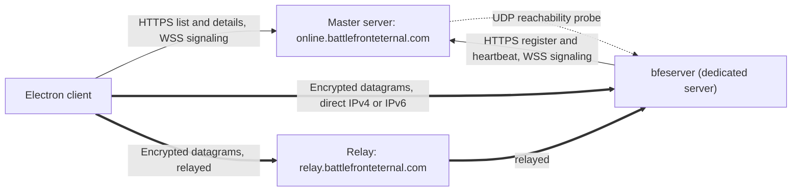

# Battlefront Eternal: multiplayer

Multiplayer works today in the desktop app on Windows and Linux: LAN games, an
online server browser with measured ping, direct connect by address, hosting
from the app, NAT punching and TURN relays, IPv4 and IPv6, locally generated
player identities, kick and ban, and an optional shared ban list. A battle
holds up to 64 players (32 a side), and bots fill the empty slots. The
transport is the engine's encrypted native UDP (BFE-UDP/1, protocol 3; see
[docs/native-udp-transport.md](docs/native-udp-transport.md)); WebRTC and
protocol 2 are retired. The dedicated server, `bfeserver`, lives in its own
public GPL-3.0 repository,
[battlefront-eternal-server](https://github.com/centrevilletech/battlefront-eternal-server),
and servers update themselves from the release channel
([docs/server-updates.md](docs/server-updates.md)). The browser development
build cannot play online.

Planned, not built yet: macOS releases (only an experimental manual build
exists, and it does not self-update), SteamCMD game acquisition and
server-data bundles for dedicated servers, TURN over TCP or TLS for networks
that block UDP, Battlefront II, and custom maps and mods.

The rest of this document is the design behind that and the roadmap beyond it.
Where a section describes something that is not built, it says so. The
networking foundation (the fixed clock, commands, snapshots, the world worker)
is in [docs/runtime-architecture.md](docs/runtime-architecture.md), and the
current wire contract is in [docs/network-contract.md](docs/network-contract.md).

*Battlefront Eternal* is the name of the project: it plays the 2004 game's maps
and, later, Battlefront II's (2005) in one engine, from the player's own copies
of the games. The Steam versions of both originals are the reference for
behavior. Multiplayer is designed for both games from the start.

## Summary

| Decision | Design |
| --- | --- |
| Electron desktop app on Windows and Linux (Omarchy and Ubuntu); macOS is planned | Sandboxed renderer, privileged networking process, signed releases |
| Players can HOST public servers from the desktop app, as well as LAN/private games | Launch the actual bfeserver runtime in the background; same public listing and relay support as a VPS |
| Dedicated servers must run on a VPS with no GPU | Standalone headless runtime; no Electron, display server, graphics context or rendering work |
| Planned: Steam sign-in is the primary CLI setup path | SteamCMD downloads the operator's owned game, then local extraction prepares server data; no desktop or GPU required. Today the operator supplies an owned copy of the game ([docs/server-updates.md](docs/server-updates.md)) |
| Planned: the client exports server world data as an alternative | Upload a versioned gameplay-only bundle; server setup asks for its path and validates it |
| Missing content means spectator-only; mixed playlists stay joinable | Lobby/scoreboard view without assets; 3D spectating only with renderable content |
| New public service repositories use GPL-3.0-only | No retail data in releases |
| Locally generated player identities are always allowed | No mandatory Steam/email/Discord account or verification-only server mode |
| Global bans with operator choice | Optional shared ban list; each operator can honor or ignore it independently of local bans |
| Closing the app offers keep-running or stop-server | Background bfeserver survives renderer exit and can be managed on reopening |
| Stats stay per server | No global aggregation or leaderboard for now |
| Launch with the BF1 GUI; a unified BF1/BF2 GUI is planned | Family-specific in-match HUDs remain separate from the front-end choice |
| Custom maps and mods are planned after launch | Reserve pack identities and compatibility metadata now |
| Official releases are stable only | One official stable update channel for client and server (releases currently ship on a development-preview channel) |
| Check and auto-update the Electron client on boot; enforce versions | Signed updates, recovery, offline startup and an explicit compatibility gate (Windows and Linux; macOS is planned) |
| Official services are run by the project, and anyone can run their own | The master's web endpoints sit behind an ordinary HTTPS reverse proxy; the relay uses separate ports; capacity and abuse limits remain necessary |
| MULTIPLAYER offers LAN and ONLINE | Also direct connect by address, as the original had; the original's screens and strings where they fit |
| The server browser shows whether this player connects directly or through a relay | Today it shows the server's relay policy; planned: per-player path checks, explicit unchecked/checking states, actual active path shown while connected |
| ONLINE lists servers from a master server at `online.battlefronteternal.com`; settings can point at any other | The master also does signaling, player identity and relay credentials; a client can list several masters and merge them |
| The master is open source, ships as a Docker container, and runs HTTPS over IPv4 and IPv6 from day one | Its own public repository; a Compose file behind an HTTPS reverse proxy, plus a compatible relay stack |
| Linux dedicated servers: one install, runs as a service, a menu instead of config files | `bfeserver`: a Node.js service running the client's own simulation; a systemd service today, with a numbered menu that works over SSH planned |
| Direct connections to a public IPv4 or IPv6 address; otherwise through `relay.battlefronteternal.com` | Native encrypted UDP (BFE-UDP/1, protocol 3) replaced WebRTC; direct, hole punching, then relay |
| A playlist editor with rules per map; optional location sharing | Location off by default for players and hosts; coarse location only when enabled |
| Notice before entering the online server browser | Explain IP processing, conditional relay use and independent operators; separate optional location permission |
| An opt-in profanity filter | Plus a client-side filter each player controls |
| A sponsor logo and website in the server browser | Logos hidden until backend approval; optional display; re-hosted by the master |
| BF1 and BF2 maps in one playlist; the HUD follows the map | Every id names its game (its family); rules and interface come per family |

## Goals

1. LAN and online play using the BF1 GUI at launch. A new unified GUI for
   both games is planned afterward; the in-match HUD follows the map family.
2. Anyone can run a dedicated server on Linux: one install command, then a
   menu. Lead with Steam sign-in to acquire and prepare owned game data on
   the server; client-exported bundles remain available. Nobody edits a config file.
3. Anyone can run the online services. The official ones are a default, not
   a dependency.
4. Reach servers directly when they have a reachable public IPv4 or IPv6
   address, through the relay otherwise. Networks permitting only HTTPS on
   TCP 443 may block the initial relay; report that limitation clearly.
5. One engine, two games. A server's playlist can mix Battlefront (2004) and
   Battlefront II (2005) maps; the client switches rules, HUD and screens per
   map.
6. Online plays like offline: the same 60 Hz rules, bots included.
7. Target 32-versus-32 armies of humans and bots, with larger battles after
   measurement. Army population and human connection caps are separate limits.
8. Aim for cinematic 4K on capable PCs and playable Performance settings on
   older machines in the same match, with identical simulation rules.

## Not goals, for now

- Talking to the retail game, GameSpy or Galaxy multiplayer. This is a new
  protocol.
- Skill-based matchmaking or ranked play. QUICK JOIN (best ping, free slots,
  content the player has) is all the matchmaking there is.
- Kernel-level anti-cheat.
- Voice chat.
- Shipping a browser-only multiplayer client in v1. The browser remains a
  development target; the release client is Electron.

## Names

| Name | What it is |
| --- | --- |
| client | The Electron desktop app for Windows and Linux (Omarchy/Ubuntu); macOS is planned. The browser development build is a web page and cannot play online |
| `bfeserver` | The dedicated server: a systemd service, with a menu planned |
| master server | `online.battlefronteternal.com`: the server list, signaling, identity, relay credentials. It is a directory, not skill-based matchmaking |
| relay | `relay.battlefronteternal.com`: authenticated forwarding for servers players cannot reach directly |
| family | Which game a map, its rules and its interface belong to: `swbf1` (2004) or `swbf2` (2005) |
| content | The gameplay data a server and its players must agree on, per map |

`bfeserver` is the command. Use it consistently in packaging, service names and
documentation.

## What the original did

The Steam build's shell data still carries the 2004 multiplayer screens'
strings (`ifs.mp.*`, `ifs.onlinelobby.*` and `ifs.onlineopt.*` in
`public/common/common.json`). They are a ready-made spec for the flow and its
wording:

- **PICK CONNECTION TYPE**: LAN, INTERNET (GameSpy, shut down in 2014), DIRECT
  CONNECTION with JOIN IP, and GALAXY MULTIPLAYER (from the Steam/GOG
  re-release).
- **PICK A SESSION TO JOIN**: GAME NAME, IN/MAX, PING, SERVER (PC or PC
  DEDICATED); SORT BY, FILTERS, REFRESH, TOTAL SERVERS, GAME INFO, and
  MISSING: %s for a map the player lacks.
- **Join errors**: one each for a session that could not be joined, a server
  running a different version, and a map the player lacks.
- **SET GAME OPTIONS**, for hosting: DEDICATED SERVER, MAX PLAYERS, AI UNITS
  PER TEAM, AI DIFFICULTY LEVEL, TEAMS: AUTO ASSIGN or PLAYER SELECT, TEAM
  DAMAGE, HEROES, SPAWN INVINCIBILITY, SHOW PLAYER NAMES, MIN PLAYERS TO
  START, PUBLIC or PRIVATE GAME, AIM ASSIST.
- **The lobby**: NAME, TEAM, PING, CONNECTION; VOTE TO BOOT, BOOT NOW, the
  mute list, FRIENDS.
- **ONLINE OPTIONS**: HOSTING BANDWIDTH (DSL/CABLE from 256 to 784 KBPS, T1+)
  and the voice settings. `optionsMenu()` already has a hidden ONLINE OPTIONS
  row for this ([docs/menus.md](docs/menus.md)).
- **In battle**: the Tab player list exists only in a network game
  ([docs/formats.md](docs/formats.md)).

Battlefront Eternal uses these strings, and the `lobby_icons` texture, where
they fit. What the options *do* (ranges, defaults, whether AI UNITS PER TEAM
counts humans) still has to be checked against the original game before the
defaults below are final.

## Two games from day one

Battlefront II support is later work. These choices cost little now and a
lot once servers and saved playlists exist.

1. **Ids name their family.** Maps, missions, sides, classes and content are
   `swbf1/hot1` and `swbf2/hot1`. The two games use the same short codes for
   different maps (Hoth is `hot1` in both), so bare ids collide. A bare id
   keeps meaning `swbf1`, so today's URLs still work. Extracted data moves to
   `public/<family>/{maps,sides,common,audio}/` before the first BF2
   extraction.
2. **Playlist entries name family, map, era and mode**: `swbf2/hot1:gcw:ctf`.
   BF1 multiplayer only has conquest, but the mode is in the format from the
   start (BF2 adds capture the flag, Hunt, Assault, space and hero modes).
   `parseRotation()` in `src/launch.js` drops both a `family/` prefix and a
   third field today.
3. **Family and Classic/Enhanced are separate axes.** In this codebase
   "Classic" means faithful to the original: Classic AI, Classic effects,
   `src/scoreboard/classic/`. A BF2 map has its own Classic HUD (BF2's), and
   could get Enhanced options too. Views are picked by family *and* style.
4. **The interface sits behind ports.** The scoreboard and spawn screen
   already split a model and port from the view (`model.js`, `port.js`,
   `classic/`). The HUD needs the same split: today `src/hud.js` lays out the
   2004 HUD and reads the world in one file. After that, a family supplies
   views and the ports stay.
5. **A family module supplies** its extractor profile; mission loading; its
   rules (movement and stances, where BF2 adds sprint and the dodge roll and
   drops prone; classes, heroes, awards, modes, capture, bleed); its interface
   (HUD, spawn screen, scoreboard, end screens, loading screen, pause menu
   theme); and its audio mapping (voice-over, music). The clock, collision,
   commands, snapshots and networking are shared.
6. **BF2's modes are scripts.** BF1's conquest rules are ported into the
   engine. BF2 writes much of its modes in Lua mission scripts
   (the mod tools ship them: `ObjectiveConquest`, `ObjectiveCTF` and so on),
   in Lua 5.0 where BF1 used 4.0 (`tools/zero_lua.py`). Running BF2's modes
   means either a Lua 5.0 runtime inside the simulation, on the server too, or
   porting each mode. Decide before BF2 work starts.
7. **The protocol names the family.** A map change carries `{family, map,
   era, mode, content hash, rules version}`. Entity state is made of
   components each family registers (BF2's stamina is one BF1 never sends),
   so a new family doesn't change the framing. Positions are quantized against
   each map's bounds, not a fixed range: BF2's space maps are far larger than
   any ground map.
8. **Content is per family and per map.** A server advertises the content its
   playlist needs, and the client compares that with what the player imported
   (see [Versions and content](#versions-and-content)). A player without BF2
   can still join a mixed server and remains spectator-only on its BF2 maps (see below).
9. **The HUD switches during loading.** The loading screen belongs to the
   incoming map's family, and the HUD, spawn screen and scoreboard swap
   behind it.

## Player experience

### Front end

The shipped front end is one MULTIPLAYER screen with JOIN and CREATE tabs. JOIN
lists INTERNET or LAN servers with filters (name, map, era, ping, hide full,
hide empty), sorting by column, measured ping, DIRECT CONNECT by address, and a
privacy notice before the first online request. CREATE hosts a LAN or public
server from the app ([docs/shell.md](docs/shell.md),
[docs/server-browser.md](docs/server-browser.md)). The design below is the
fuller target; favorites, recent servers, QUICK JOIN, region filters and share
links are planned.

MAIN MENU → MULTIPLAYER → PICK CONNECTION TYPE:

- **LAN**: servers on this network ([LAN](#lan)).
- **ONLINE**: the master servers' lists.
- **HOST**: start a LAN or online server using the same playlist and rules
  editor as the dedicated server.
- **JOIN IP**: an address or a join code. Online servers also get links
  (`https://play.battlefronteternal.com/join/<server id>` or similar) to share
  on Discord and the like.

LAN and ONLINE share one session list:

- Columns: GAME NAME, GAME (BF, BFII or both), MAP, IN/MAX (and bots), PING,
  CONNECTION, region. Icons for a password, a sponsor and missing content.
  CONNECTION shows this player's measured path: DIRECT or RELAY, with
  UNCHECKED / CHECKING before a path is established and UNREACHABLE when
  all allowed paths fail. It is not a server-wide label from the master.
- FILTERS: game, not full, not empty, no password, ping under N, region, and
  "only servers I can play" (content and version).
- SORT BY any column; REFRESH; TOTAL SERVERS.
- Tabs: ALL, FAVORITES, RECENT. A favorite follows the server's key, not its
  address.
- QUICK JOIN: the best playable server by ping and free slots.
- GAME INFO: the description and message, the rotation (with each map's
  game), the rules (reinforcements, AI, teams, heroes, team damage), the
  players (name, score, ping), the sponsor's logo and website, and MISSING: %s
  for spectator-only entry, or the version message when the player cannot join.

Joining: ENTER PASSWORD: if needed, JOINING SESSION ..., the content and
version check, the loading screen, then the spawn screen (or the spectator
lobby for missing content). Failures use the original’s messages.

In battle: Tab's scoreboard (implemented: every player and bot with kills,
deaths and command post points, and each player's ping; the original's
network list has only the players' names, teams, pings and kills), chat (all
and team), VOTE TO BOOT, and an admin menu for admins. The GAME
OPTIONS that are rules (friendly fire, AI, difficulty, heroes, battle size)
belong to the server while connected and show read-only: the host's ruleset is
authoritative online.

ONLINE OPTIONS: the player's name; profile export and import
([Identity](#identity-admins-moderation)); the master servers (official by
default, others added or removed); optional coarse location sharing (off by
default, independently enabled); hide profanity; show sponsor art; a connection
test (public IPv4 and IPv6, NAT behaviour, relay reachable).

### Online entry notice and optional location

Before the first server-list request, probe, rendezvous or relay allocation,
show a bundled notice identifying the selected master/service operator, with
**Continue to Online**, **Back**, **Privacy Policy** and **Terms** actions.
Continuing acknowledges the notice and requests online connectivity; merely
opening the notice sends no game-network requests. Back leaves offline/LAN
play available. Apply the same notice to online HOST and direct online joins,
including deep links, so bypassing the browser does not bypass disclosure.
Remember the notice version locally; show it again for material changes or a
new service operator. Keep it accessible from ONLINE OPTIONS. Explain that
opening externally hosted policy links itself contacts that website.

Draft player-facing wording, subject to legal review before release:

> Online services use your IP address and connection information to find
> games, establish connections and protect the service from abuse. The selected
> server-list service receives your IP when you browse. Connection checks may
> also contact game servers and connectivity services. If your connection uses
> a relay, that relay receives and processes your IP address and connection
> metadata to forward game traffic. Direct or Relay is shown for your connection.
>
> Location sharing is optional and off by default. Disabling it does not hide
> your IP address from services you contact; IP addresses may reveal an
> approximate location.
>
> Community servers are independently operated. Their operators may collect
> player information, chat, gameplay activity and connection data under their
> own policies. We do not control their data collection or the content and
> conduct of their users. Listings are not endorsements. You may encounter
> offensive or inappropriate content; use mute, block, report or leave.
>
> By choosing Continue to Online, you acknowledge this notice and request
> connection to the selected online services. Read the Privacy Policy and
> Terms for data handling, operator responsibilities and applicable limitations
> of liability.

The full official policy must identify the actual operator/contact, data
categories, purposes, lawful basis, recipients, retention/deletion periods,
rights and relevant hosting locations/transfers before public launch. Distinguish
transient IP processing needed to route packets from stored IP logs; define
which logs exist and their retention rather than implying indefinite storage.
Game servers may receive a player's IP on direct connections/probes; on relayed
paths address disclosure depends on signaling and transport implementation.
Do not advertise relay use as player anonymity.

GAME INFO should identify an independent operator and expose its supplied
privacy/rules links when available; absent links show “Policy not provided.”
Official logo approval is not approval of that operator’s data practices or
all server content. Official services retain their own reporting/delisting
controls and responsibility for their own processing.

Location is a separate opt-in, never a condition of online play. Both player
and host defaults are off. No GPS/OS geolocation, GeoIP enrichment or inferred
public region is requested/published automatically. Explain the use and
recipient when enabling location; allow disabling/removing it in settings.
Do not put player coordinates in server listings. A host can publish a coarse
region or rounded coordinates, preview them first, and remove them later.
Without shared location, show “Not shared”; measured ping, Direct/Relay status,
joining and relay selection by measured reachability/latency still work.
Location/region filters must offer inclusion of servers without shared location.

Implementation/legal distinction: notice acknowledgment is not blanket consent
to arbitrary collection or a universal liability waiver. Determine the lawful
basis for necessary network processing separately from optional location
consent. Final Terms should address independent-server content and liability
only to the extent applicable law permits; obtain jurisdiction-specific legal
review rather than asserting “we are not responsible for anything.” The
[ICO consent guidance](https://ico.org.uk/for-organisations/uk-gdpr-guidance-and-resources/lawful-basis/a-guide-to-lawful-basis/consent/)
describes the requirements for freely given, specific, informed opt-in consent;
its [transparency guidance](https://ico.org.uk/media/for-organisations/guide-to-the-general-data-protection-regulation-gdpr/individual-rights/right-to-be-informed-1-0.pdf)
lists the information to provide when collecting personal data.

### Ping and missing content

The desktop measures each listed server's ping on the player's own machine: how
long a TCP connection to the server's game port takes to open, the lowest over
the server's addresses, with no answer within a second shown as no ping
([docs/server-browser.md](docs/server-browser.md)). Only addresses from master
listings, LAN discovery or an address the player typed are probed. Geographic
estimates may seed sorting later, but they must be labeled estimates and give
way to measured ping.

The shipped browser's link label (DIRECT, RELAYED, LAN or DIRECT OR RELAY)
comes from the server's relay policy. Planned: a CONNECTION column that
reflects a connection preflight for this player and server. Check the selected
server first, with bounded background checks for visible rows; do not allocate
relay sessions for the entire list. A direct ping alone does not prove the
authenticated game connection will work. Mark DIRECT or RELAY only once the
transport confirms a usable path; cache results briefly and invalidate them
when either endpoint or the local network changes. A master reachability result
or relay policy is only a hint.

GAME INFO would show Direct (IPv4/IPv6) or Relay (relay location, when
available), and the measured round trip over that path. Hole-punched
peer-to-peer paths count as Direct. Relay ping must measure the complete
player-to-game-server round trip through the relay, not just latency to the
relay itself. Optional location-based estimates remain labeled estimates while
checks run.

Joining confirms the actual selected path and replaces the preflight result.
Keep Direct/Relay visible in the connected session/player list and connection
details; update it if the transport switches paths or reconnects. Show a
checking/reconnecting state while no active path exists. Two players on the
same server may see different labels and pings, which is expected.

A missing map never forces a player out of a mixed playlist. They remain
connected as spectator-only and can see the lobby, score, chat and next map.
Today a client whose game data differs from the server's connects as a
spectator, and the status line says why. Without the map’s geometry and
textures there is no 3D world to display.
Follow cameras require the needed presentation assets and compatible data;
otherwise the UI explains what is missing. No retail files are downloaded
from a server to fill the gap. Recheck content at every map transition and
when an import finishes; a compatible player can then use the spawn screen.
The server gates spawning on that state, and spectators have separate slot
and bandwidth limits. Spectator feeds must also respect anti-ghosting rules
(team restrictions or delay), including players who claim missing content.

## Architecture



- **bfeserver** runs the client's own world: `createGame()` headless, as the
  local server in the world worker does
  ([docs/runtime-architecture.md](docs/runtime-architecture.md)). Under Node it
  needs a data port that reads files instead of fetching URLs. One battle per
  process. The connection layer outlives battles, so a map change builds a
  new world while players stay connected. Bots run here.
  The standalone server must run on a GPU-free VPS without Electron,
  Chromium, a display server, WebGL or software rendering. CPU-side math and
  collision dependencies are fine; creating a graphics context is not.
- **The master** is small: a server list held in memory, signaling, probes,
  and SQLite for keys, bans, sponsor art and reports.
- **The relay** is coturn: the native transport uses its UDP allocations.
- **The client** talks HTTPS/WSS to masters. Its privileged network process
  owns game connections and LAN sockets; the renderer receives bounded data
  through a narrow IPC bridge.

Running the client's simulation code is the main reason to write the server
in Node: prediction and authority share rule implementations. Matching code still
needs parity tests across runtimes and platforms.

## Netcode

[docs/runtime-architecture.md](docs/runtime-architecture.md) fixes the model:
server authority with prediction and reconciliation, not lockstep; commands,
not positions. This section adds what the network changes.

- **Authority.** The server runs the fixed 60 Hz tick (vehicles keep their
  120 Hz substeps). Clients send commands: held keys, ordered action edges,
  look deltas, spawn-screen choices (`command.human`). Speed, teleport,
  damage and ammo are validated by the server. Client-supplied results are
  rejected; authority still needs correct validation and testing.
- **Clock.** A client aims each command at the server tick it should arrive
  for (estimated offset, plus half the round trip, plus a small margin), and
  adjusts gradually, never by jumps.
- **Input lanes.** Held movement and cumulative mouse totals travel as
  latest-state datagrams; a later total recovers mouse motion lost in an
  earlier packet. Discrete actions and fire edges use independently
  acknowledged sequences, repeated until acknowledged or explicitly expired,
  so a newer movement acknowledgement cannot discard a delayed jump, reload or
  short trigger press. The mailboxes reject duplicates, stale lives and
  malformed payloads, and keep stale-input limits and the authoritative firing
  rules. Three recent commands alone would not guarantee that an action
  survives a longer loss burst.
- **Prediction** covers the player's own soldier or driven vehicle, with the
  same rules. On each snapshot: restore, drop acknowledged commands, replay
  the rest (`CommandHistory`). Input production and local prediction must
  continue when downstream snapshots stall, with bounded replay history and
  explicit recovery when the retained history no longer covers authority.
  An input receipt/execution acknowledgment can release resend bookkeeping;
  only a matching applied authoritative state can release replay history.
  Gunners predict their own aim and see the hull interpolated.
- **Everyone else** is interpolated between received snapshots on a playout
  clock that follows measured jitter.
- **Snapshot rate**: 30 Hz online (every second simulation tick) against the
  60 Hz simulation, each snapshot delta-encoded against the last one the
  client acknowledged
  ([docs/snapshot-delta-design.md](docs/snapshot-delta-design.md)). Rendering
  interpolates across actual snapshot intervals. Higher publication rates
  remain subject to the bandwidth and CPU gates below.
- **Joining mid-battle**: the entity registry and a welcome, then a full
  snapshot against the empty baseline, then deltas.
- **Map changes**: the server announces the next entry, the end screens play,
  and the server builds the new world. Clients load it (with the incoming
  family's loading screen) and report ready. A slow loader joins when ready.
- **Disconnects**: a player who reconnects within a minute keeps team, score
  and slot (matched by player key). After that, a bot takes the slot.

### Bandwidth

Both sides run the same world and definitions, so only state and events need
to travel. What goes over the wire is gameplay, and compact:

- **Send gameplay, not presentation.** Send compact gameplay events (unit 12
  fired weapon 1; post 3 changed hands) and let each client make the sound,
  the flash and the bolt from the same definitions.
- **Binary and quantized**: positions in fixed point against the map's
  bounds, angles in 16 bits, health and timers in a byte where that's enough.
- **Deltas against what the client confirmed.** Over UDP the base is the last
  snapshot each client acknowledged. Gameplay events (kills, captures,
  spawns, messages) go on the reliable channel, never inside a snapshot that
  can be dropped.
- **Whole snapshots, not per-entity rationing.** Every relevant entity is in
  every snapshot. Each datagram stays under 1,100 bytes (actual UDP
  fragmentation must still be measured), and a client over its byte budget
  skips whole snapshots. Numbered semantic events cover the simulation ticks
  between snapshots, independently of snapshot delivery.

Capacity planning uses about 30 KB/s per player. At that budget a 32-player
server sends about 1 MB/s (8 Mbit/s), and a 64-player one 16 Mbit/s. It is a
planning budget, not a measurement; the size estimates for a full battle in
[docs/snapshot-delta-design.md](docs/snapshot-delta-design.md) are higher
(about 40 to 50 KB/s). That's fine on a VPS or fiber and tight on cable
upload. The server measures what it sends and caps players to fit: the
original's HOSTING BANDWIDTH, measured instead of asked.

### Wire contract

Online play uses one contract with nothing to negotiate: protocol `3` (the
native UDP transport, [BFE-UDP/1](docs/native-udp-transport.md)), the current
simulation revision and profile `snapshot-delta-v1`
([docs/network-contract.md](docs/network-contract.md)). Direct connections, the
server browser, LAN and desktop HOST use it without a URL switch. Both
identities are proven inside the transport handshake; a client or server on a
different contract gets an update-required error. WebRTC (protocol 2) and its
ordered-snapshot, journal and interim profiles are retired and cannot be
negotiated. Single Player runs the same simulation host locally behind a local
transport.

The requirements behind it:

- One protocol revision with fixed required behavior. Transport, input
  encoding, acknowledgment rules and entity schemas are one tested contract,
  not independently selectable capabilities; incompatible peers are rejected
  clearly.
- State is replaceable and expires. Admission bounds queued bytes before
  encoding and before transport submission. Do not wait for an acknowledgment
  before publishing another state: bounded unsent work is not stop-and-wait.
- No recurring reliable checkpoint, whole-world reset, or ordered
  presentation stream may be required for gameplay to advance. Reliable
  join/control traffic remains available.
- Snapshots are delta-encoded against a baseline the client acknowledged, so a
  lost datagram needs no repair bookkeeping. Each datagram is useful on its
  own: a lost one costs only its contents.
- Own-player corrections contain the state required for physics replay, not
  merely position and velocity. Persistent presentation is desired state;
  numbered semantic events drive transient fire, impact and death feedback.
- Qualify with the actual transport, reproducible loss profiles,
  downstream-only blackouts, and 8/32/64-player loads. Separate simulation,
  compression, application queueing and delivered state age. Round-trip time
  alone cannot isolate one-way queue delay. Report delivered payload
  separately from actual wire bytes.

This contract is an implementation decision, not a claim that bandwidth, CPU,
64-player capacity, or every gameplay route has passed acceptance. Desktop HOST
packages a matching server revision and engine together.

### Shots

Blaster bolts are slow, visible projectiles, not hitscan, which makes lag
compensation harder than in most shooters. The shooter's client draws its bolt
at once, tagged as predicted so it isn't drawn twice. The server spawns the
real bolt advanced along its path by the shooter's latency. It tests the
skipped stretch against targets rewound to where the shooter saw them, using
immutable hitbox samples, and checks current world geometry. Rewind and
catch-up are capped (the current limits are in
[docs/network-contract.md](docs/network-contract.md) and
[docs/semantic-combat.md](docs/semantic-combat.md)). Old timestamps clamp to
the cap; future timestamps receive no compensation. Dead targets and a new
respawn generation cannot be hit through an old sample. Sniper bolts follow
the same rule. The cap still requires online playtesting; fixture tests alone
do not establish perceived fairness.

### Bots

- The Classic AI throttles bots away from the camera: "within 45 m of camera
  0, or inside any camera's frustum" (`src/ai/classic/scheduler.js`). On a
  server, every human's view has to count. The server works each view out
  from the player's soldier and viewpoint setting, rather than trusting the
  client. Offline keeps the original first-camera radius; online the 45 m
  radius applies around every human.
- Bots fill each army to its configured population. A human replaces a bot;
  a full human team rejects further assignments. The current target is 32 per
  team, with the human connection cap configured separately. Reconnect grace
  reserves the slot for 60 seconds, then a bot fills it.

### Server cost

A full 32-versus-32 battle's world tick measured about 3 ms at p50 and 5 ms at
p99 ([docs/snapshot-delta-design.md](docs/snapshot-delta-design.md)). The
runtime budget is p95 under 8 ms at 44 to 64 units. Snapshot encoding must be
shared work: changes found once per tick, then a cheap step per client. One
battle per process and one process per core; several servers on one machine
run as separate instances.

## Transport

Electron removes the browser restriction on sockets: Node’s
[`dgram`](https://nodejs.org/api/dgram.html) supports UDP sockets, IPv4
broadcast and multicast membership. Socket access belongs in the privileged
network process, not the page rendering the UI.

**Native UDP for the lowest latency.** WebRTC's per-connection SCTP congestion
control and reliable-channel retransmission were the measured source of state
backlog under loss. The replacement is
[BFE-UDP/1](docs/native-udp-transport.md), written for this game in
`src/net/` and shared by the desktop network process and bfeserver. It uses
only standard primitives from Node and Electron's crypto (X25519, Ed25519,
HKDF-SHA256, AES-256-GCM) in established constructions: a SIGMA-I handshake
as TLS 1.3 uses, QUIC's acknowledgement ranges and loss detection, and
WireGuard-style session ids, roaming and replay windows. No library was
pinned: Node's QUIC support is experimental and absent from Electron's Node,
and the maintained alternatives need native modules on both ends. Its
handshake, parsers and trust boundaries had a security review
([docs/native-udp-security-review.md](docs/native-udp-security-review.md)).

Required behavior, as implemented:

- `state`: unordered, loss-tolerant commands and snapshots; stale state is
  dropped, and queues stay bounded.
- `events`: reliable gameplay events, chat and map transitions; ordered where
  their dependencies require it, with duplicate suppression.
- `bulk`: reliable, rate-limited manifests/rules/approved sponsor art; no
  head-of-line blocking of current state and no retail asset distribution.
- Authenticated, encrypted sessions, replay protection and connection-bound
  player proofs; certificate/key fingerprints pinned by listing or join code.
  Manual LAN/IP first contact uses an explicit trust-on-first-use step.
- Direct IPv4/IPv6 joins and LAN discovery without any master, DNS service or
  internet access: the handshake goes straight to the address.
- Direct paths first, coordinated hole punching when needed, authenticated
  relay fallback, path liveness and recovery after network changes.
- Congestion control, MTU-aware packet sizing, backpressure and send budgets;
  measure around a 1,200-byte datagram ceiling rather than fragmenting packets.

One transport interface separates this choice from the simulation and wire
schema (`NetworkSession` over `UdpTransport`; `GameSession` over `UdpPeer`).
The relay path works through coturn because only the server (or a client
launched with `relay=always`) speaks TURN, over a UDP allocation; the other
end sends plain UDP to the relayed address. TURN over TCP or TLS for networks
that block UDP is not implemented on the native transport; those players
cannot join until it is.

## Connectivity

At startup, and every few minutes after that, the server checks how it can be
reached:

- **IPv4**: its public address, by STUN against the relay. It's behind NAT if
  that differs from its own address.
- **IPv6**: its global addresses. It advertises the stable one, not the
  temporary privacy addresses, which rotate.
- **Reachability**: after the server registers, the master probes each
  advertised address and port from outside and reports whether IPv4 and IPv6
  are reachable.
- **Home routers**: automatic port mapping (PCP, then NAT-PMP, then UPnP) is
  planned. Today an operator opens the game port (UDP and TCP 18451 by default,
  see [docs/native-udp-transport.md](docs/native-udp-transport.md)) or sets the
  relay policy to always. Such mappings cannot be assumed to traverse an
  upstream carrier NAT; relay fallback remains required.

Then the native transport's connect tries, at once (the first authentic
handshake reply wins, direct paths given a 60 ms lead):

1. **Direct**, over whichever address family both sides have. IPv6 often works
   where IPv4 sits behind carrier-grade NAT.
2. **Hole punched**: both sides send at once, and their NATs or IPv6 firewalls
   let the replies in. Success depends on NAT mapping/filtering behavior; carrier-grade NAT does
   not always rule it out, and no NAT type guarantees success.
3. **Relayed.**

A server keeps an outbound relay allocation/session when direct paths are
unavailable; cross-family forwarding must be tested with the chosen transport. An IPv4-only player can then still reach an IPv6-only server
(common at home, behind IPv4 carrier-grade NAT) through the relay, which has
both.

Relay policy, per server: **auto** (the default: relay only where direct
fails), **never**, or **always**. Always must suppress direct addresses in listings, signaling and probes as
well as relay game traffic. It limits exposure of a home host’s address; it
cannot hide an address already known or eliminate denial-of-service risk.

### Relay

The official relay is coturn at `relay.battlefronteternal.com`. Measure the
host's bandwidth allowance, shared-host headroom, player latency and abuse
controls before setting capacity.

- coturn listens on UDP/TCP 3478, with TURN over TLS on TCP 5349. TURN is not
  HTTP; an HTTPS reverse proxy cannot forward it, so the relay keeps its own
  ports and TCP 443 stays with the web proxy. Gameplay keeps its end-to-end
  transport encryption through the relay. The native transport uses UDP
  allocations only.
- TURN/TCP and TURN/TLS as blocked-UDP fallbacks need a native client
  implementation (TCP framing of ChannelData) before they help anyone.
  Networks permitting only TCP 443 may still fail; this is an accepted
  limitation for now, not a promise of universal connectivity.
- Relay credentials are valid for five minutes. A relayed session lasting
  longer depends on coturn accepting the allocation's refreshes; make-before-
  break reallocation with in-session migration is planned, not implemented.
- A future WSS relay could use the HTTPS proxy on 443 only if the chosen
  transport supports that adapter and passes queue, congestion and latency
  tests. Coturn behind an HTTP proxy is not that adapter. Another future
  option is a dedicated relay IP; neither is required for now.
- No open relay: short-lived credentials, authenticated allocations, per-key
  and per-address connection/traffic limits, bounded queues, and no relay
  access to loopback, private, link-local or metadata destinations.
- At 30 KB/s per player, 32 players receive roughly 1 MB/s or 2.6 TB/month
  continuously. Relay capacity planning counts both ingress and egress,
  commands, packet overhead and burst headroom; this is a budget, not a
  measurement. Track throughput, loss, p95 latency and allocation count.
- Start from one location, measuring real player paths. Add regional relays
  where the latency warrants it; plentiful bandwidth does not remove the
  geographic detour.
- `/v1/info` advertises each master's compatible relays and policies.
  Choosing a community master selects its relays, not its software updates.

### LAN

- bfeserver and in-client hosts answer bounded IPv4 discovery broadcasts and
  IPv6 link-local multicast queries.
- The Electron network process enumerates usable interfaces, preserving IPv6
  scope IDs. Deduplicate by server key; account for multiple NICs and VPNs.
- No internet, master, GeoIP or relay is required. JOIN IP remains available
  across routed subnets or where Wi-Fi isolation blocks discovery.
- Package and test OS firewall/local-network permissions on Windows, Ubuntu
  and Omarchy (and on macOS once it is supported). Electron socket access does
  not bypass OS permissions. Handle denial with a clear message and retry
  action.
- Bind only configured interfaces and validate discovery messages before
  allocation; do not broadcast beyond local links.

### Hosting from the client

HOST launches the actual **bfeserver runtime** as a background process from
Electron, with a bundled runtime for Windows and Linux (macOS is planned). It
uses the same server entry point, simulation, protocol and configuration model
as the standalone Linux service. The local player joins through the normal
connection interface; the UI manages the process through local authenticated
IPC.

Offer LAN-only, private online and **public online**. A public app-hosted
server registers with the master and appears in ONLINE exactly like a VPS
server, with the same playlist, password, rules, bans and approved sponsor
settings. Public hosting does not require a dedicated machine or a public IP:
use direct connectivity where reachable and the relay where necessary.

Minimizing the renderer must not suspend the server. Pausing opens the local
menu without stopping the multiplayer clock. Closing the app with an active
host offers **Keep server running in background**, **Stop server and quit**,
and **Cancel**. Keeping it running closes the UI/local player connection but
leaves bfeserver, remote players, master registration and relay sessions alive.
Reopening the app discovers and authenticates to its existing local server;
it must not spawn a duplicate. Keep a local management/stop command available
when the renderer is closed. Show the session status before the player exits.

The server process lifetime must be independent of the Electron parent when
keep-running is selected; test that on every desktop platform. Sleep, OS
shutdown or a server-process crash still interrupts hosting; warn about sleep
while hosting. Stopping the server notifies players and unregisters it. No
host migration is planned for v1. Hosted matches use the same relay path as
standalone servers. Client updates may not terminate or replace the running
server's runtime/data: defer shared-runtime updates until the server stops,
or use versioned runtimes and a backward-compatible local management protocol.

Hosting adds full simulation cost to rendering and prediction. Recommend a
dedicated host for larger battles; being an Electron app does not guarantee
that an older PC can host 64 players.

## The dedicated server: bfeserver

`bfeserver` is the dedicated server, in its own public GPL-3.0 repository
([battlefront-eternal-server](https://github.com/centrevilletech/battlefront-eternal-server)).
It runs on a GPU-free Linux VPS, serves up to 64 players (32 a side) with bots
filling the empty slots, and is the same runtime the desktop app launches for
HOST. What runs today is the systemd service described in
[docs/server-updates.md](docs/server-updates.md). The install packages, the
setup menu, the command line and the Steam acquisition below are planned
design, and are marked as such.

### Headless performance requirement

A GPU-free VPS is a first-class deployment target. Install only the server
runtime, transport and gameplay data; no desktop app or graphical session is
required. The process runs simulation, AI, collision, network encoding and
administration, with no rendering, visual animation, audio playback, texture
loading or GPU initialization. Retain animation data/math that affects game
rules or collision, even though no animated model is drawn.

The Electron host and VPS host must produce the same gameplay results for
the same inputs. A VPS dedicates its resources to serving the battle; an
app-hosting PC also pays for the local player's renderer and prediction.
Measure tick time, encoding time, memory and bandwidth under real player/bot
load; headless operation removes presentation cost but does not guarantee
capacity on an undersized or heavily shared VPS.

### Install and updates

Today a Linux server runs `bfeserver.service` under systemd with its own Node
runtime (under `/opt/bfeserver` by default) and keeps its state and
`config.json` in `/var/lib/bfeserver`. It updates itself: a systemd timer
follows the signed release channel, installs each release's engine and server
adapter, prepares that release's game data from the operator's owned copy of
the game, and swaps the service over once nobody is playing
([docs/server-updates.md](docs/server-updates.md)). One installation can run
several servers (`bfeserver-<name>.service`, each with its own state folder,
ports and identity). The game port (UDP and TCP 18451 by default) must be open
to players.

Planned:

- A one-line installer that detects the distribution and architecture (x86-64,
  arm64), adds a signed apt or dnf repository and installs the package, with
  `.deb` and `.rpm` downloads and a Docker image as alternatives.
- A `bfeserver` system user and group, so that the menu works without sudo.
- A setup mode: the service runs, but is neither listed nor joinable until it
  has game data and a name.
- Targets: Ubuntu LTS and Debian stable first, then Fedora and RHEL; ARM cloud
  machines; a Raspberry Pi 5, if the tick cost allows.

### Game data

Today the operator puts an owned copy of the game on the server (the folder
holding `GameData`), and the server prepares its own data from it with the
release's tools, as the desktop client does
([docs/server-updates.md](docs/server-updates.md),
[docs/desktop.md](docs/desktop.md)). The rest of this section is planned work.

The planned primary operator workflow is **install → run `bfeserver` → sign in
to Steam → download owned game files → prepare server data → host**. It would
work from an SSH terminal on a GPU-free VPS, without copying files from a PC.
SteamCMD acquisition is not implemented; title/depot access must pass the
validation below before it can be advertised as working.

First-run GAME DATA would lead with:

```
 GET GAME DATA

  1  Sign in to Steam and download my game (recommended)
  2  Import a server-data bundle exported by Battlefront Eternal
  3  Import an existing game installation folder
  0  Back
```

#### Steam sign-in and download (planned)

1. Explain that the operator signs into Valve’s SteamCMD on this machine to
   download a supported game they own. Battlefront Eternal's master and relay
   never receive Steam credentials. This is data acquisition, separate from
   any future Steam-based player identity or admin permissions.
2. Run Valve’s SteamCMD as an unprivileged, isolated import helper. Handle
   interactive account login and whatever Steam Guard challenge SteamCMD
   presents; never require disabling Steam Guard. Keep password/code input
   out of process arguments, shell history, application logs and telemetry.
3. Offer supported retail editions explicitly, starting with Battlefront
   (2004); BF2 becomes available when its importer exists. Check entitlement
   and download access through SteamCMD and explain missing licenses or
   unavailable depots. Do not assume anonymous downloads or that ownership
   of one edition grants another.
4. Use a controlled staging directory and the Windows platform override for
   Windows game data. Download and validate files, showing progress and disk
   requirements. No Wine, Windows program or graphics context is needed to
   extract data; the only thing that runs is our headless server engine.
5. Extract with the pinned server-data profile, then validate and atomically
   activate the same canonical bundle format used by client exports. Show
   imported maps, source build and gameplay hashes before continuing setup.
6. End the Steam session and remove helper authentication state by default.
   An explicit “Remember Steam login on this server” option may retain only
   SteamCMD-managed authentication state in a restricted directory, with a
   Forget action. Never store the password in bfeserver config. Exclude auth
   state from backups, exports and support bundles; verify cleanup behavior
   in testing rather than assuming logout erases cached credentials.

SteamCMD download/authentication behavior is documented by Valve in its
[SteamCMD guide](https://developer.valvesoftware.com/wiki/SteamCMD) and
[Steamworks upload/download documentation](https://partner.steamgames.com/doc/sdk/uploading).
Validate the exact retail app IDs, depot access, Steam Guard flow, concurrent
Steam-client session behavior and Linux dependencies with an owned account.
The native Linux SteamCMD helper's architecture requirements are separate
from the game server’s: qualify x86-64 first, and retain bundle import on ARM
unless a supported acquisition route is proven. No claim of universal title
or host-architecture support before testing.

Authentication/download failure offers retry or either import alternative;
it never replaces working server data. Reboots and ordinary matches use the
installed data without signing into Steam again. Steam downloads/extraction
are explicit maintenance operations; upstream game updates cannot silently
change live content hashes or disrupt an active battle.

#### Import alternatives and common bundle format (planned)

For client export, the desktop app imports the operator’s own retail files,
then GAME DATA → EXPORT SERVER DATA creates a bundle for selected maps and
families. Upload it through normal file transfer and choose its path in the
CLI. Existing game folders use the same local extraction helper as Steam
imports. These paths support operators who use other retail sources or do
not want Steam authentication state on their VPS.

The systemd service has no interactive stdin: `bfeserver` owns setup prompts.
Until data is ready the service remains in setup mode; subsequent boots reuse
installed data. The menu can add or replace data through any supported source.

The bundle contains collision, terrain, regions, spawn paths, posts, mission
setup, class/weapon/vehicle properties, AI navigation and animations used by
gameplay (such as droideka movement). Exclude render-only meshes, textures and
audio. Headless loader auditing must establish the actual dependency closure;
today’s mixed extraction output cannot simply have every mesh deleted.

Proposed manifest: schema and extractor versions, family/map/era/mode IDs,
compatible simulation data version, dependency list, file sizes and hashes,
and a canonical gameplay content hash per map. Client and server hash the
same canonical gameplay data; presentation changes do not break compatibility.
Hashes establish integrity/agreement, not proof that a remote client is honest.

Import validates schema, file counts, sizes, dependencies and hashes before
activation. Reject absolute paths, traversal, symlinks and archive bombs;
unpack as the service user into staging, then activate atomically. Keep the
last working bundle on failure. Show missing maps and required re-exports in
the menu; a bundle never supplies executable engine code.

Retail-derived bundles stay private and outside source repositories, release
packages, masters and relays ([CONTRIBUTING.md](CONTRIBUTING.md)). Open-source
engine code does not change that boundary. No automatic sharing of missing
retail assets.

The existing extractor is Python (`tools/extract.py` and its helpers). Package
a versioned helper for desktop imports and CLI Steam/folder imports; do not
make a JavaScript rewrite a prerequisite. The headless profile must exclude
presentation-only processing and dependencies, including audio conversion.
Provision its required Python/native dependencies through setup. Bundle-only
import and the running server need neither Python nor SteamCMD. The
distribution must account for Valve’s SteamCMD distribution terms; provision
the official helper rather than assuming it can be repackaged.

### The menu (planned)

The current server is configured through `config.json` in its state folder (see
the battlefront-eternal-server README). The menu and commands below are the
planned interface.

`bfeserver` with no arguments opens the menu: numbered choices, keyboard
only, working over SSH in 80×24 and without colour. It talks to the running
service over a local socket. Leaving the menu leaves the server running.
Changes apply as soon as they can: the name at once, the playlist at the next
map, ports after a restart (which the menu offers).

```
 BATTLEFRONT ETERNAL SERVER · Theed Thursdays                        v0.4.2
 Running · NABOO: THEED (CW) · 14/32 players, 18 bots · up 3d 4h
 IPv4 reachable · IPv6 reachable · relay standby

  1  Live         players, chat, kick, ban, next map
  2  Playlist     maps and their rules
  3  Server       name, password, max players, location, message
  4  Network      port, reachability test, relay, master servers
  5  Moderation   bans, admins, profanity filter, votes
  6  Sponsor      logo and website in the server browser
  7  Game data    Steam sign-in/download, import, verify
  8  Service      start and stop, logs, updates, backup
  0  Leave the menu (the server keeps running)
```

The first run goes straight through setup:

1. **Sign in to Steam and download owned game data** (recommended), or import
   a client-exported bundle/existing installation. Extract, validate and install.
2. The server's name.
3. Optional location sharing, off by default. Skip, enter a coarse region, or
   explicitly request a GeoIP suggestion and confirm before publishing it.
4. The playlist: every imported map, with the original rules.
5. Public, private or password.
6. The reachability test. The menu offers to open the port in ufw or
   firewalld if either is active, and tries PCP and UPnP. If the server is
   still unreachable, it says players will come through the relay.
7. Live.

The playlist editor adds, removes, duplicates and reorders entries. It edits
each entry's rules (below) or applies a change to all of them. It sets PLAY
IN ORDER or RANDOM ORDER, as Instant Action does, and holds at most 64
entries, the original's mission queue (`MAX_PLAYLIST`).

Everything in the menu is also a command, for scripts:

```sh
bfeserver status --json
bfeserver data steam     # interactive login, download and server-data preparation
bfeserver data import /path/to/server-data.bundle
bfeserver playlist add swbf1/nab2 --era cw --reinforcements 250 --ai 16 --teams auto
bfeserver playlist move 3 1
bfeserver ban add <player id> --days 7 --reason "team killing"
bfeserver say "Map change in one minute"
bfeserver config export > theed.json    # and import: backups, cloning
bfeserver logs -f
bfeserver update
```

- **No config files to edit.** The service keeps its state in
  `/var/lib/bfeserver/*.json`. Only the service writes it, and it stays
  readable for backups. Docker users can pass the same settings as
  environment variables or a mounted export.
- **Several servers on one machine** run today as `bfeserver-<name>.service`
  units that share one installation and release
  ([docs/server-updates.md](docs/server-updates.md)); the menu would ask which
  one.
- **Running it**: an unprivileged user; systemd sandboxing (no new privileges,
  a read-only system, a private `/tmp`); restart on crash; no admin port on
  the network (the menu's socket is local). Updates apply once nobody is
  playing. Optional extras: a Discord webhook for up and down, full, and
  reports; a local metrics endpoint (tick time, players, bandwidth) for graphs.

### Server settings

This is the target set of settings. Today the server reads its name,
description, location, sponsor, rotation and bots from `config.json`
([docs/server-browser.md](docs/server-browser.md)).

| Setting | Notes |
| --- | --- |
| Name, description, message of the day | Filtered on the official master |
| Public or private | Private is unlisted and joinable by code or address (the original's PUBLIC GAME / PRIVATE GAME) |
| Password | Optional |
| Max players | Up to 64 (32 a side) with bots filling the empty slots; also capped by the measured upload |
| Location | Optional, off by default. Publish only an operator-approved coarse region or rounded coordinates (0.1°); otherwise omit coordinates, region and country. No automatic GeoIP publication |
| Language, tags | For the list's filters |
| Profanity filter | Off unless the operator turns it on |
| Sponsor | Logo and website |
| Admins | Player keys |
| Block list | By player key, name pattern, IP address or prefix; permanent or timed, with a reason. An allow-list mode makes a server private to a clan |
| Global bans | Honor or ignore the project’s signed ban feed; local bans still apply |
| Votes | VOTE TO BOOT and vote to skip the map; thresholds, cooldowns |
| Idle kick, ping limit, reserved admin slots | |
| Master servers | Official by default; more can be added |
| Relay | Auto, never or always |
| Updates | Follow the release channel; applied once nobody is playing, or held by the operator |

The block list is server-wide rather than per map, so a ban doesn't lapse at a
map change.

### Rules per playlist entry

| Rule | Values | Default |
| --- | --- | --- |
| Game, map, era, mode | `swbf1/nab2`, `cw` or `gcw`, `conquest` | |
| Reinforcements | A count, or a percentage of the mission's | The mission's (200 a side on `bes2r`) |
| AI units per team | 0 up to the mission's unit count | The mission's (25 on `bes2r`) |
| AI difficulty | Easy, medium, hard | Medium |
| Teams | AUTO ASSIGN or PLAYER SELECT | AUTO ASSIGN |
| Team balance | The largest difference allowed when players pick | 1 |
| Heroes | On, off | The mission's |
| Team damage | On, off | On, as in 2004 |
| Spawn invincibility | Seconds | The original's |
| Show player names | On, off | On |
| Min players to start | A number | 0 |
| Max players | Overrides the server's | The server's |
| Time limit | Off, or minutes | Off (BF2's modes need it) |
| Bleed | The mission's, or off | The mission's |

### Profanity filter

- Opt-in per server. It covers chat and the player names shown on that
  server. Actions: mask (the default), drop, mute after N offences, kick after
  N.
- Matching ignores case, repeated letters, leetspeak, look-alike Unicode and
  invisible characters. Word lists come per language, with an allow list for
  innocent words that contain bad ones, and the admin can add words.
- Separately, every player has a client-side option to hide profanity,
  whatever the server does.
- The official master filters server names, descriptions and sponsor text
  itself.

### Sponsor

Today a sponsor is a name, an `https:` website and a logo address in the
server's `config.json`; the desktop browser shows the name and site, and does
not show logos yet ([docs/server-browser.md](docs/server-browser.md)). The rest
of this section is the planned design.

- The operator gives a logo (PNG, JPEG or WebP, up to 512 KB; not SVG, which
  can carry script) and an `https:` website.
- The server uploads both to the master. The master re-encodes the logo at
  fixed sizes (512×128 and 256×64 WebP, for example), strips its metadata and
  serves it from its own domain. Clients never load images from game servers
  or third-party hosts: no tracking pixels, no leaked addresses, no hostile
  files.
- Logos are hidden until approved in the master’s backend. Approval is bound
  to the image hash and website; edits return the submission to pending. The
  backend supports pending/approved/rejected/revoked states and an audit log.
  Clients honor revocation and never display a pending image from a direct
  server URL. Each community master moderates its own submissions. GAME INFO
  has a report button, and a master can delist a server.
- The website shows as its domain, with punycode visible. Clicking asks "Open
  example.com in your browser?" and opens the validated HTTPS URL in the system browser. Never load sponsor
  pages inside a privileged Electron window.
- The logo shows in GAME INFO, and also on the server's loading screen and
  scoreboard if the operator wants. Players can turn sponsor art off.
- On an offline LAN, display only cached art with a valid approval record
  from a trusted master, under a bounded cache lifetime; otherwise show a
  placeholder. LAN transfer is not a bypass for approval. Disabling sponsor
  art hides it in every view.

## The master server

The engine, client, dedicated server, master and relay are open source. The
master has its own repository
([battlefront-eternal-master](https://github.com/centrevilletech/battlefront-eternal-master))
and Docker image, and its Compose file runs behind any HTTPS reverse proxy. The
relay is a separate coturn stack
([battlefront-eternal-relay](https://github.com/centrevilletech/battlefront-eternal-relay)),
and community hosts supply their own proxy. No repository or image includes retail data.
Project-authored code is GPL-3.0-only (see
[Publication and privacy](#publication-and-privacy)); dependency licenses stay
explicit.

### API, v1 sketch

| Endpoint | What it does |
| --- | --- |
| `POST /v1/servers` | Register: the server's key, signed info and addresses. The master probes, then lists |
| `PUT /v1/servers/{id}` | Heartbeat every 20 s: map, players, rotation, state; signed |
| `DELETE /v1/servers/{id}` | Clean shutdown |
| `GET /v1/servers` | The list: compact, cached, with an ETag |
| `GET /v1/servers/{id}` | Details: players, rotation, rules, sponsor |
| `GET /v1/whoami` | The caller's address as the master sees it; `v4.` and `v6.` host names give each family |
| `WSS /v1/signal` | Connection rendezvous/signaling. Servers keep one open |
| `POST /v1/relay-credentials` | Short-lived credentials for the chosen relay |
| `POST /v1/reports` | Report a player or a server |
| `GET /v1/bans` | Signed global player-ban feed with expiry/revocation; operators choose enforcement |
| `GET /v1/info` | This master's name, relays, rules and public key |

A server that misses three heartbeats (about a minute) leaves the list. The
list is public, with CORS open, so websites and Discord bots can show
servers.

### Abuse

- A server can list only addresses that answered the probe, or the address it
  connects from. Otherwise anyone could list a victim's address and aim every
  client's pings at it. Master server lists have been abused that way.
- The master probes only registering addresses, and slowly. It must not
  become a traffic cannon itself.
- Rate limits per IPv4 address and per IPv6 /64 and /56, since one machine
  can have billions of IPv6 addresses. There's a cap on servers per address,
  raised for verified operators such as hosting companies.
- A server is its key, not its address. Favorites and bans survive address
  changes, and a key can be delisted.
- On the official master, names, descriptions and sponsor art are filtered
  and reportable.

### Federation

The client keeps a list of masters, official first, and merges what they
list; a server can register with several. GameSpy's shutdown in 2014 took the
original's online play with it. If the official service ever goes away, the
game keeps working with any community master.

### Dual-stack Docker

- Explicitly configure and test IPv4 and IPv6 listeners, DNS and container
  networking. Preserve source addresses for probes and rate limits; a proxy
  address is not the client address. Host networking is a deployment option
  for the UDP relay, subject to the selected implementation’s port needs.
- A reverse proxy terminates master HTTPS/WSS on TCP 443. Trust forwarded
  addresses only from the configured proxy, overwrite spoofed forwarding
  headers there, and block direct backend access. Coturn terminates its own TLS
  on TCP 5349, separate from the HTTPS listener.
- Test IPv4-only, IPv6-only and NAT64 clients; test relay crossings in both
  directions rather than assuming dual-stack DNS solves connectivity.

## Identity, admins, moderation

A block list needs stable identities. Names change at will, and addresses
are shared (carrier-grade NAT) or rotate (IPv6 privacy addresses).

- A player profile is a key pair the client makes and keeps (in protected app profile storage, using OS credential protection where available). The player ID is a hash of the public
  key; the name is only a label. The client proves it holds the key when it
  connects, by signing a challenge bound to the authenticated session transcript and a fresh server nonce.
- Export and import (a passphrase-protected file) keep a profile across machines or a reinstall. Never include private keys in world exports.
- Locally generated identities are always supported, online and on LAN.
  Steam, email or Discord verification is never a prerequisite to play, and
  the supported server policy has no verification-only mode. Optional account
  linking may be added later for convenience, without extra gameplay access.
  SteamCMD sign-in for downloading owned files grants no player/admin rights.
- Bans target player keys, with optional operator-controlled IP/prefix bans.
  Players can generate replacement keys; acknowledge that ban evasion remains
  possible. Do not solve it by requiring a third-party account. Shared IPs
  also make address bans imperfect, so keep reasons, expiry and appeal paths.
- The project can issue global player bans through a signed, versioned feed.
  Each operator chooses **Honor global bans** or **Ignore global bans**;
  local bans apply in either mode. The default is to honor (the desktop HOST
  does), plainly shown in setup and adjustable in Moderation. Ignoring the feed
  must actually allow those players to join unless the operator has separately
  banned them.
- Feed entries contain the player key, ban ID, public reason category, issue
  time, expiry and revocation state; keep private reports/evidence off the
  public feed. Cache validated feeds, apply removals promptly and show stale
  feed status during outages. A feed outage cannot become a verification
  requirement or an unconditional denial of all joins.
- Enforce this optional global player-ban feed at the game server, not through
  mandatory master/relay admission checks that would override operator choice.
  Official infrastructure can still rate-limit attacks or delist abusive
  servers under its own service policy; distinguish those actions from an
  operator's player-ban preference.
- On a LAN, keys are the only identity.
- Admins are player keys, promoted from the menu's Live page. They kick,
  ban, mute and change the map from an in-game admin menu or with chat
  commands. Every action is logged with the admin who took it.
- Players can mute and block others client-side, and report them. Reports
  go to the server's log, and reports about a server to the master.

## Versions and content

Protocol and simulation must match before a session is accepted; content
must match before spawning. Missing/mismatched content permits only the
spectator state described above:

| What | Changes when | On a mismatch |
| --- | --- | --- |
| Protocol version | The wire format changes | The join is refused with an update-required message |
| Simulation build | Any rule the client predicts changes (movement, weapons, collision) | The same, since prediction would fight the server |
| Content hash, per map | The retail data or the extractor's gameplay output changes | MISSING: %s; remain spectator-only until compatible content is available |

- The master advertises protocol, simulation build and content requirements.
  The server rechecks them in the authenticated handshake; a compatible
  listing is not permission to bypass that check. A content-only mismatch
  allows spectator mode, but a protocol/simulation mismatch rejects the join.
- Auto-updating clients does not update community servers. Publish coordinated
  client/server releases, show upgrade status in the server menu, and reject
  incompatible joins with the required version. Define an explicit tested
  compatibility window; never silently load executable code from a game server.

- Hash only the gameplay data, so a new texture pipeline doesn't split the
  player base. Copies from different sources (the 2004 disc, the Steam and GOG
  releases) may still differ in gameplay data; find out which agree.

### Desktop releases and boot updates

Official client and server releases use one **stable** channel. Do not enroll
players or operators in beta/nightly updates. Development builds are separate
and must not replace an official installation through its updater. (Releases
currently ship on a development-preview channel.)

On boot, check the trusted release feed, download and verify an available
update, install it and relaunch before entering online play or hosting.
Show progress and retry on failure; never apply an update mid-match. A failed
check must not prevent offline play or compatible offline LAN sessions.
When online, incompatible servers remain unavailable regardless of update state.

- Windows: signed installer and updater; test a clean machine and upgrades.
- macOS (planned): signed and notarized distribution outside the App Store;
  test both supported CPU architectures. Signing is required for Electron’s
  macOS updater.
- Linux and Windows (implemented, [docs/desktop-updates.md](docs/desktop-updates.md)):
  every installation, the Debian package, the AppImage or the Windows
  installer, installs signed releases into the user's own folder and hands
  off to the newest at launch, so no update needs administrator rights or a
  package manager. Only changed files download.
- Authenticate update manifests and artifacts against release keys shipped
  with the app; a checksum from an untrusted feed is insufficient. Separate
  update trust from selectable masters; selecting one grants no code execution.
- Stage atomically, keep recovery to the last working signed build, and test
  interruption/disk-full cases. Store profiles and imported content separately
  from the app; migrations must preserve backups and support recovery.

### Older PCs

A remote server removes the full battle’s AI and authoritative simulation
from the client, which should help CPU-limited PCs. The client still renders,
animates, mixes audio, decodes snapshots and predicts/reconciles its own
soldier or vehicle, including necessary collision work. Electron also adds
memory overhead. GPU-limited PCs will still need graphics scaling. Hosting
locally retains the full simulation cost. Measure minimum-spec CPU/GPU/RAM
and frame times; do not promise that all math moves to the server.

## Security

- Every packet from the internet is hostile. Decoders check sizes and counts
  before allocating (the in-process `InputMailbox` already validates shapes
  and caps), and they get fuzzed.
- Server authority is most of the anti-cheat: commands come in, and the
  server decides the results.
- Open source is a standing requirement: security must not depend on hiding
  code or a secret shipped inside it. Enforce action rates, movement, inventory,
  team/seat access and command tick windows at the server; bound rewind history.
  Never trust client content claims or a build string as anti-cheat attestation.
- The client is JavaScript anyone can change, so aim help and seeing through
  walls stay possible. The limits: don't send units far outside relevance
  (distance first, map visibility later); flag statistical outliers; record
  demos that admins can review; VOTE TO BOOT.
- Rate limits on chat, votes, spawns and team changes.
- Clients authenticate servers by the certificate fingerprint in the listing
  or the join code.
- The menu is local only. No admin port faces the network.
- Electron renderer: sandbox on, `contextIsolation: true`, `nodeIntegration: false`; narrow typed preload APIs, validated IPC sender and payload, no
  generic filesystem/shell/socket bridge. Treat names, chat, MOTD and logos as
  untrusted content. Follow the [Electron security guidance](https://www.electronjs.org/docs/latest/tutorial/security).

## Publication and privacy

The product is **Battlefront Eternal**, the server command is **bfeserver**,
and the default services are `online.battlefronteternal.com` (the master) and
`relay.battlefronteternal.com` (the relay).

Project-authored engine, client, dedicated server/CLI, master and relay code
use **GPL-3.0-only**, and new public service repositories use version 3 only
(see [LICENSE](LICENSE) and [CONTRIBUTING.md](CONTRIBUTING.md)). Third-party
components retain their own licenses. Retail assets remain user-supplied and
excluded from source and binary releases.

Publish the full policy and reviewed Terms behind the
[online entry notice](#online-entry-notice-and-optional-location), with explicit
address/log retention, deletion and moderation policies. A direct connection
exposes peer addresses; relay-only mode must suppress address advertisement
to reduce that exposure. Players need profanity hiding, mute/block, reports
and clear descriptions of each server's moderation.

## Launch scope and planned follow-up

- **Stats:** per-server only for now, keyed by local player identity. No master
  aggregation or global leaderboard. Operators own storage, retention and
  reset policies and disclose them to players. Detailed stat fields and
  export/backup format remain implementation work.
- **Interface:** BF1 GUI at launch, with Battlefront Eternal branding. A new
  unified front end covering BF1 and BF2 is in scope for later work. Keep the
  menu model separate from its view; the map-family HUD rule is unchanged.
- **Custom content:** custom maps and mods are in scope after launch. Reserve
  namespaced pack IDs, dependency/version manifests and compatibility checks
  now. Permissions, sandboxing and any opt-in download/distribution flow need
  a later design; automatic downloads are out of scope until then.
- **Spectators/replays:** the missing-content spectator lobby is part of the
  design. The timing of 3D spectator cameras and downloadable match replays is
  open; they stay in planned follow-up unless prioritized.

## Open work

Most of what remains is engineering and validation rather than product
direction:

1. Native UDP follow-ups: TURN over TCP/TLS for networks that block UDP, relay
   reallocation across credential expiry, 64-player qualification on separate
   machines, and continued review of the BFE-UDP/1 handshake
   ([docs/native-udp-security-review.md](docs/native-udp-security-review.md)).
2. Desktop: macOS support (planned), with packaging and signing; boot updates
   and background-server lifecycle tests on Windows, Ubuntu and Omarchy;
   extraction helpers and server-data bundles; SteamCMD acquisition.
3. Original host defaults: AI UNITS PER TEAM with humans, spawn invincibility,
   player caps and hosting bandwidth behavior; check them against the original
   game before setting defaults.
4. BF2 scripted modes: evaluate a Lua 5.0 runtime versus mode ports.
5. Measured player and spectator limits, bandwidth and tick/encoding cost;
   relay capacity, regions and abuse policy.
6. Bundle dependency closure, canonical hashing and retail-edition
   equivalence.
7. Implementable details for custom packs and the later unified GUI.

## Validation plan

Each of these answers a question before the design leans on it:

- **Steam onboarding and bundles** (planned features): validate owned BF1
  downloads through SteamCMD on a clean x86-64 Linux VPS, including Steam
  Guard, missing entitlement, interrupted downloads, credential
  redaction/cleanup and helper dependencies. Compare Steam/folder extraction
  hashes with desktop-exported bundles from the same source build and
  extractor, then run `createGame()` from a gameplay-only bundle and compare
  results and tick cost with the client import.
- **GPU-free server**: run a full battle on a clean Linux VM with no display
  server, Electron, Chromium or software-rendering packages, and compare the
  simulation results with the bfeserver process launched from the desktop app.
- **Offline LAN and hosting**: three machines discover and join with WAN
  disabled; IPv4 and IPv6, firewall denial, multiple interfaces, minimized
  host window, host exit and sleep/wake. Test manual IP with no discovery.
- **Relay**: cross-family joins in both directions, carrier-grade NAT, blocked
  UDP fallback, relay-only address suppression and path recovery. Once the
  browser shows a per-player path, verify that it shows Direct for one player
  and Relay for another on the same server, measures end-to-end ping, and
  updates after path changes without presenting unchecked or stale paths as
  current results.
- **Wire size and weak PCs**: gameplay events and deltas in a 64-unit Bespin
  battle; average and peak per-client bytes against the budget, encoder cost,
  main-thread frame time, prediction and memory overhead.
- **Packaging and updates**: import/export on all desktop targets, interrupted
  update recovery, offline launch and content preservation; keep-running versus
  stop-server on app exit, reattachment without a duplicate process, and
  updater behavior with an active background server.
- **Online disclosure and location**: no online directory, probe or relay
  traffic before acknowledgment, and Back preserves offline/LAN play. Test
  online HOST and deep-link entry, operator/notice changes, optional-location
  defaults and removal, and joins and relay selection with no shared location.
- **Identity and bans**: a local key can join without any third-party account;
  the same banned key is rejected by an honoring server and accepted by an
  ignoring server unless locally banned. Test signatures, feed outages,
  expirations, revocations and moderation audit records.

## Roadmap

| Planned work | Done when |
| --- | --- |
| Relay hardening: TURN over TCP/TLS, reallocation across credential expiry, capacity and abuse controls | A server behind carrier-grade NAT is joinable, including by players on networks that block UDP; IPv4-only players can join IPv6-only servers |
| Dedicated-server setup: SteamCMD acquisition, server-data bundles, the menu and CLI, packages | An operator prepares a GPU-free VPS through Steam sign-in or bundle import, then three PCs join without editing config files |
| 64-player qualification | Full battles on separate machines meet the tick, bandwidth and delivered-state-age gates |
| macOS | Signed, notarized builds that self-update |
| Battlefront II | BF2 extraction, the swbf2 rules and interface, mixed playlists, content checks and spectator transitions between families; a rotation alternates BF1 and BF2 maps, each with its own HUD |
| Follow-up | Custom maps/mods, a unified BF1/BF2 GUI, and advanced spectator cameras and replays (timing open); each gets its own implementation and validation plan |
| Later consideration | Voice, optional account linking, any global stats proposal; no launch dependency |
