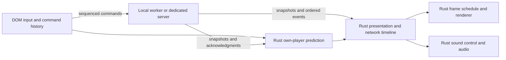

# Runtime timing and ownership

The Electron app runs a headless authoritative world in a worker for local
battles. An online client instead receives that world's snapshots from
`bfeserver`. Both authorities use the Rust simulation compiled to WebAssembly.
The native client can join a server using its Rust UDP transport and the shared
presentation and rendering crates; it is separate from the Electron host.

## World tick

`src/runtime/fixed-clock.js` schedules integer 60 Hz gameplay ticks. Vehicle
physics keeps its 120 Hz substeps. Display refresh, graphics settings and frame
caps do not change these rates. Host timers wake the world; elapsed monotonic
time determines how many fixed steps are due. Catch-up work is bounded and
remaining debt is reported rather than hidden by a larger simulation dt.

The host admits external input and prepares retained owner banks, then calls
one world operation through `src/runtime/world-tick.js`. The Rust coordinator
in `rust/sim/src/world/step.rs` advances water, squad commands, the viewpoint
clock and camera, AI, units/vehicles/recon/separation, live objects, ordnance,
items, the battle tail and grenade dangers. It returns a generated
`WorldTickOutput`. The host delivers notices and completes the clock after
that interval. There is no JavaScript phase dispatcher inside the tick.

`rust/sim/src/world/owner.rs` owns the canonical store, collision, movement,
pose, AI, fleet, unit, combat, ordnance, battle, input, wire and page services.
Internal calls borrow those owners. Damage, death, boarding and shot callbacks
keep their original observation order. Completed publication commits changed
rows against the host's consumed baseline.

Production startup uses the validated WASM backend. The native Context and
store arenas share engine code, but native phase compilation is distinct from
an exposed and qualified native world host. See [node-host.md](node-host.md).

## Threads and data flow

One owner mutates authoritative world state. Prediction uses private state and
replays unacknowledged commands without editing the authority. Displayed bodies,
hulls, riders, props, weapons and effects are sampled by Rust presentation.
The page retains host resources, scene anchors and the facts needed by its
remaining consumers. Authoritative muzzle, rider and collision geometry is
computed from native rigs even in a headless battle.

The page never waits synchronously for a world or network reply. It draws the
available state. Bounded snapshot and event transport lets world ticks continue
through a renderer stall; reliable input and events are not discarded with a
superseded transform sample. Local pause and suspension are explicit messages.
An online authority continues while a client loses focus or reconnects.

Browser events, pointer lock and DOM menus remain on the page. Audio workers
and worklets consume Rust commands and PCM. Electron's network process owns
sockets and communicates through bounded IPC. A native client owns its window,
input devices, UDP connection and audio device directly.

## Input, prediction and snapshots

- Commands distinguish capture time from assigned simulation tick. Sequence,
  session epoch, body generation, held state, ordered action edges and raw look
  samples qualify what the world consumes.
- Raw mouse counts are displacement. They are not multiplied by render dt.
  Sensitivity, zoom and posture rules apply at their defined input boundary.
  Short presses survive slow frames. Clearing input releases held controls.
- Spawn, class, team and respawn choices are command data. Admission validates
  their bounds and the current player's life; stale commands cannot control a
  replacement body or seat.
- Snapshots contain values and qualified identities, not live Three.js object
  graphs. Lifecycle, seats, inventory, weapon state and presentation events
  have explicit records.
- Rust prediction restores an authoritative checkpoint, removes acknowledged
  input and replays the pending records using the shared movement, vehicle,
  weapon and recon cores. Visual correction is smoothed separately from
  authoritative collision state.
- The Rust network owner decodes received baselines and samples retained
  timelines. Remote interpolation uses a bounded delay and extrapolation;
  immediate local look does not inherit that remote delay.
- Gameplay random streams remain separate from visual randomness. Whole-world
  replay must include admission, clock, command and stream state, not only a
  seed. Floating-point agreement is checked against recorded reference output.

The game uses server authority and reconciliation. It does not require every
client to simulate an entire battle in deterministic lockstep. See
[network-contract.md](network-contract.md),
[network-replay-contract.md](network-replay-contract.md) and
[world-replay.md](world-replay.md).

## Presentation and rendering

Rust presentation computes the gameplay camera, displayed poses, skin data,
ordnance and item views. Rust rendering derives shadow, reflection, probe and
far cameras, lighting, resource descriptors and the complete battle frame
schedule. The browser supplies remaining scene facts and executes host I/O;
it does not dispatch the post chain or issue Three.js battle draws.

Frame caps skip presentation callbacks without skipping authority ticks.
Adaptive resolution changes the back buffer, using available GPU timing or
fence evidence, within the configured limits. Quality changes must not alter
battle populations, decision budgets or gameplay dt.

The native client uses the same `battle_frame` schedule for its admitted map,
recorded-session and online views. Supporting an online snapshot consumer does
not establish support for an interactive local authoritative battle. Its modes
and current limitations are in [native-client.md](native-client.md).

## Validation and performance

`tools/world-hash-matrix.mjs` compares state, deep digest and publication hashes
against a frozen reference. Native phase fixtures and recorded input replays
check shared core behavior. Browser checks also exercise worker stalls, camera
response, prediction, interpolation and drawn output; a headless hash cannot
establish that a page presents leases or frames correctly.

Use `tools/desktop-world-advance.mjs` for a running desktop world's clocks and
errors. Renderer corpus and native-session tools compare drawn pixels through
the actual Rust frame schedule. [renderer-smoke.md](renderer-smoke.md) describes
content-free GPU checks; [host-qualification.md](host-qualification.md) covers
server lifecycle, load and network acceptance.

Stable 30 FPS on weaker PCs is a target, not a guaranteed minimum hardware
specification. Measure the same content, population, camera and settings on the
target device. Report page CPU, world ticks, GPU cost, memory and input latency
separately. A stopped world or software renderer cannot qualify a performance
improvement. Existing measurements and their scope are in
[performance.md](performance.md) and [render-performance.md](render-performance.md).
