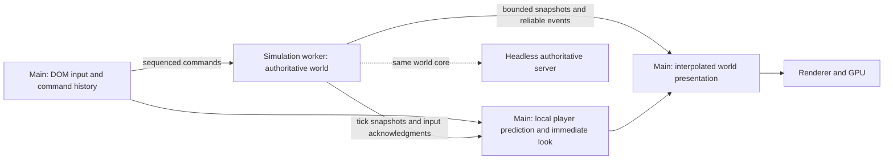

# Runtime timing, threads, and the foundation for networking

Local and remote games share one path. Every page uses `NetworkSession` and
`EntityGameState`. Single player and Instant Action run a local server
(`createLocalServer` in `src/runtime/local-server.js`, hosted by
`local-server-worker.js`) in the world worker, using the same multiplayer world,
input edges, corrections and entity host that a hosted or dedicated server uses;
a remote battle arrives over the native UDP transport
([native-udp-transport.md](native-udp-transport.md)). Only the transport and
the publication budget differ, and the wire contract is in
[network-contract.md](network-contract.md). The page never steps a battle: it
predicts the player's own state, draws everyone else between received
snapshots, and runs presentation. This is the listen-server model of Quake and
Source: the local player runs the same client code, protocol and prediction as
a remote one.

## Current runtime

- **One world, many hosts.** `src/game.js` assembles the same world for the
  page, the world worker, the dedicated server and Node tests, and steps it
  only when it is headless: `createGame({ headless: true })` is the
  authoritative world that the local server, the dedicated server and the tests
  run. A headless host builds no WebGL, DOM, texture loaders or audio device and
  skips drawing, but the shared core still uses Three.js math, skeletons and
  scene objects for kinematic transforms; it is not a minimal pure-data world.
- **One clock.** `FixedClock` owns integer 60 Hz gameplay ticks (movement,
  weapons, projectiles, contacts, services, capture, spawning), with 120 Hz
  vehicle substeps. Render refresh, graphics presets and frame caps do not
  change those rules, and catch-up work is bounded per callback, with the
  remaining debt reported, not discarded.
- **Input.** Bounded counted action queues, sequenced commands and replay
  history, raw look samples, generation checks and explicit clear/suspend
  handling; infantry look previews immediately between ticks. Gameplay uses its
  own camera and aim transforms and explicit RNG streams, kept apart from
  cosmetics.
- **State and presentation.** The world worker has a bounded input mailbox, a
  separately acknowledged reliable event queue, suspension and explicit faults,
  so a stalled renderer skips presentation without stopping world ticks. Unit
  weapon and throw state, repair locks, stations and tow cables have persistent
  records; weapon actions, lightning, shield and death effects, pickups, service
  sounds and squad feedback are explicit presentation events. Pause and tab
  hiding suspend the worker directly.
- **Armies.** Local armies keep each mission's population, capped at 32 per
  team; online armies reject larger requests. The hosting UI allows at most 64
  human players in total, replacing bots within those same army slots.
- **Graphics.** Minimum, Performance, Balanced and High presets; an optional
  frame cap (30 to 240) that skips presentation work, never gameplay ticks;
  and adaptive resolution that changes only the back buffer, within 50 to
  100% of the selected scale (never under a quarter of the window), lowering
  slowly on sustained GPU evidence: timer queries, or per-frame fences where
  there are none.
- **Checks.** `tests/local-server-checks.js` and `tests/local-map-matrix.mjs`
  compare selected canonical gameplay state in one Chromium runtime (page
  corrections, a 720-tick replay, renderer-stall isolation, every imported
  Instant Action map and era for 1,800 authority ticks). They are not complete
  save/restore or cross-browser deterministic lockstep.

The sections below keep the original audit's rationale, the contracts the
runtime still follows, and how to profile and reproduce measurements. Their
figures describe the checkpoints they name, not the current tree.

## Performance targets

The target is a stable **30 FPS on weaker PCs**, while stronger machines
render as fast as the display allows. Gameplay stays at 60 Hz in either case.
The qualification matrix starts at 720p/30 with Performance settings,
1080p/60 with Balanced, and native resolution/high refresh with High quality.
These are targets to measure, not guaranteed minimum hardware specifications.
Keep the same battle population and rules when comparing presets. Test
warm-cache play, first encounter/spawn/weapon effects, sustained combat,
focus loss, and 50/100/250 ms stalls; report p50/p95/p99 frame and tick cost,
GPU time, debt, allocation/GC and input-to-submit timing separately.

Reducing back-buffer resolution and avoiding blocking GPU reads follows
[MDN's WebGL guidance](https://developer.mozilla.org/en-US/docs/Web/API/WebGL_API/WebGL_best_practices).
Software-rendered browser tests validate behavior; they cannot qualify
low-end GPU performance. User quality choices remain available even when
automatic GPU timing is unsupported.

## Camera and frame pacing

The player's rendered and simulation chase cameras use a responsive orbit: aim
and interpolated feet are followed directly, and only local stance offsets and
release from walls are eased. Five clearance rays still retract the boom
immediately at obstructions. An earlier version also filtered aim rotation
(30/s) and camera translation (15/s), so the view kept moving for about 0.21
seconds after the mouse stopped, with no expensive rendering or world work
involved. The older camera mode remains the default for existing mounted-camera
callers; mechanical aiming rules are unchanged.

A frame cap uses a small bounded deadline tolerance: timestamp variation of
about 0.08 ms around its exact deadlines could otherwise discard alternating
refreshes, and the tolerance neither accumulates drift nor issues catch-up
renders. Visual smoothing runs only on presented frames, so capped callbacks do
not consume elapsed time twice. The FPS counter uses real elapsed presentation
time rather than capped cosmetic time, and its DOM text updates four times per
second.

Foliage keeps one static card geometry per foliage class and instances it at
visible patches. Camera orientation, wind and distance fade run in the vertex
shader, and only a changed patch selection is uploaded, so camera movement does
not rewrite every leaf vertex. `Foliage` retains its CPU path as the comparison
oracle.

Regression checks: `tests/theed-camera-browser.mjs` (input through the complete
player camera path at 30, 60, 144 and 240 Hz, walking and turning, both
perspectives), `tests/foliage-gpu-browser.mjs`, `tests/camera.test.js` and
`tests/runtime-pacing.test.js`.

## Decision

Adopt one fixed-step, headless world simulation with a dedicated worker as
its browser host. Keep responsive local input/view prediction and rendering
independent of that worker. The same world core runs on the authoritative
server. Fix ownership and clock boundaries before relocating the current frame
function into a worker.

Start with 60 Hz world ticks and the existing 120 Hz vehicle substeps. These
are the initial compatibility settings, not a universal optimum. Keep
Classic decision budgets and rules intact at the chosen compatibility tick.
Do not scale AI intelligence with monitor refresh rate. Higher rendering
refresh remains useful; it must not increase authoritative simulation speed.

The first worker should own AI **and** the world it queries: movement,
collision, weapons, projectiles, seats, damage, capture, and spawning. Moving
only path searches would leave substantial main-thread physics work and add
asynchronous result timing to a previously ordered Classic scheduler.

## What the audit found

`tools/audit-runtime.mjs` ran Theed (Classic Medium, seed 1, heroes off,
original visual effects, drawing disabled) at several render rates before
gameplay moved onto the fixed clock. Each fresh page got the same seeded
startup and ten simulated seconds of warmup, with identical recorded unit IDs,
generations, positions and health across cases. Gameplay work ran once per
render call, so it scaled with the frame rate: over twelve seconds, human
weapon and projectile updates came to 360 at 30 render calls a second and 2,880
at 240, and the same seeded battle recorded 32, 20, 9 and 9 shots at 30, 60, 144
and 240. That is a counterexample to whole-game frame-rate independence, not
proof that any one subsystem caused every divergence: projectile update dt,
spawn/capture cadence, camera-dependent Classic scheduling and render-time
random consumers each needed separate controls in the replay suite. One-tick
differences that remained with fixed physics came from floating-point
accumulator boundaries, so an integer tick index and robust elapsed-time
accounting replaced repeated float subtraction as the source of truth.

In the same audit, inclusive CPU totals over a twelve-second run (about 2 s for
bot ticks, 1.3 s for foliage, 1 s for bot presentation, 0.6 s for AI updates and
0.5 s for vehicles, with collision timings overlapping those categories) located
the work. They did not establish the user's FPS, a GPU bottleneck or
input-to-photon latency, and they showed why moving AI decisions alone would not
have been enough.

What the audit required, and what still governs changes to the runtime:

- Separate wall, simulation, presentation and server clocks, and account for
  overload explicitly; preserve phase order and 120 Hz vehicle integration.
- Run every authoritative update (human combat, ordnance, services, items,
  water damage, capture, spawn) on world ticks, and keep only visual updates in
  presentation.
- Ordered, sequenced commands with discrete edges and held-state changes; a set
  of action names would turn two pending presses into one.
- Timestamped raw look deltas assigned to command intervals, with an immediate
  view response and the documented Classic turn limits preserved.
- Separate actor-view lifecycle from authoritative spawn; pool and prewarm views
  without changing class RNG or roster decisions.
- Headless gameplay transforms and injected outputs: no render visibility
  determines a hit.
- Explicit saved gameplay RNG streams; cosmetic randomness cannot perturb the
  simulation.
- One owner per world and query context; never mutate a shared JS object
  concurrently.
- Explicit pause and rebase offline and resync online; never replay minutes of
  hidden-tab debt.

`tools/audit-input-timing.mjs` reproduces two input limitations. Two `Mouse0`
presses before consumption produce `[true, false]`. Nine batches of 100 mouse
counts over nine ticks rotate -0.87890625 radians, while one 900-count batch
after those ticks rotates -0.53333333: sensitivity to callback/tick grouping at
the native look cap. It does not measure operating system event batching and
does not authorize simply removing the Classic cap. The engine already requests
unadjusted pointer-lock movement where supported; raw mouse acquisition and
network reconciliation are separate parts of the latency path. See the
browser's [Pointer Lock guidance](https://developer.mozilla.org/en-US/docs/Web/API/Pointer_Lock_API).

## Thread ownership and data flow



One thread owns authoritative world mutation. The main thread owns browser
events, menus, pointer lock, the visible camera, and initially Three.js
presentation. Prediction owns a separate local state; it never writes into
the worker's authoritative objects. Collision assets can be immutable and
reused, while query scratch and dynamic-body transforms remain instance-owned.
Audio's existing workers/worklets remain separate and consume deduplicated
events through the established audio interface.

Headless does not mean discarding gameplay animation or camera semantics.
Droideka clip-driven movement and vehicle muzzle kinematics need authoritative
data evaluators even without a mesh. Classic's camera-dependent scheduling
needs a tick-stamped view description, independent of the rendered camera
object, with one view per human online; the original scheduling policy is not
changed silently.

**Vehicle.render split.** A hull's pose has two parts.
`Vehicle.aimTick(alpha, dt)` is the tick's part, run by the simulation host (the
world worker or the server): it places the hull at the tick's pose, advances its
age and walk cycle, applies the walk pose only where a seat's turret node,
aimer, fire point or rider hangs from an animated bone (the AT-AT's head under
its bobbing root), and poses each manned seat's aim.
`Vehicle.render(alpha, dt)` is the drawn pose, the page's, with no integration.

The renderer must never wait synchronously for a worker or a network reply.
It draws available state. Worker timers are wakeups, not precise clocks:
elapsed monotonic time schedules fixed ticks. Batch work is bounded so input
messages get serviced. Overload is measured as debt; tick numbers never skip
unexecuted simulation. Sustained overload needs a declared policy and a
diagnostic, not a silently increased dt.

Browser workers have a separate execution context and cannot directly access
the DOM. Ordinary object messages clone data; transferables move ownership.
That makes a data boundary necessary, not optional.
[MDN worker guidance](https://developer.mozilla.org/en-US/docs/Web/API/Web_Workers_API/Using_web_workers).

Use pooled transferable buffers first. The experiment ran without
cross-origin isolation, and its small state payloads did not justify shared
memory complexity; shared memory also needs cross-origin isolation (COOP/COEP)
on every host. Never busy-wait on the UI thread; blocking `Atomics.wait` is not
available there, and neither side waits.
[Isolation requirements](https://developer.mozilla.org/en-US/docs/Web/API/Window/crossOriginIsolated),
[Atomics.wait](https://developer.mozilla.org/en-US/docs/Web/JavaScript/Reference/Global_Objects/Atomics/wait).

An OffscreenCanvas render worker is a possible second isolation step if
measured scene updates/submission still delay input after world migration.
It requires moving the renderer's DOM dependencies and resource ownership,
and does not create extra GPU capacity. Keep a supported fallback and qualify
actual browser/device combinations before making it the only path.
[OffscreenCanvas](https://developer.mozilla.org/en-US/docs/Web/API/OffscreenCanvas).

## Commands, snapshots, and replay contract

- A command carries schema version, session epoch, player/life generation,
  monotonically increasing sequence, intended simulation tick, held axes,
  ordered action edges, and accumulated timestamped look deltas. Capture time
  and assigned tick are distinct. Weapon commands retain the aim associated
  with that command; later camera motion cannot retroactively change a shot.
- Raw mouse counts are displacement, not velocity: do not multiply them by
  render dt. Preserve zoom/sensitivity/posture rules at an explicit boundary.
  Short press/release pairs survive slow frames. Focus loss, pointer-lock loss,
  disconnect, and restart release held controls and invalidate old commands.
- The spawn screen's choices (team, spawn as a class at a post, the pause
  menu's RESPAWN) are command data too: an ordered `command.human` list,
  validated by the mailbox and applied at one point of the tick, so a worker
  or replay applies them on the same tick ([human-spawn.md](human-spawn.md)).
- Validate command sequence, epoch, bounds and allowed action count. Bound
  queues and expose overflow. Coalesce held-state and motion updates only
  when doing so preserves intervening edges and look-cap semantics. Do not
  quietly overwrite jump/fire/reload edges.
- Snapshots carry version, epoch, tick, simulation time, acknowledged input
  sequence, and entity ID/generation. Position, orientation, velocity and
  animation intent are values, not live class/Three.js object graphs.
  Lifecycle changes, inventory, damage, and seats are explicit data.
- A slow renderer may miss intermediate *presentation snapshots*. The
  simulation keeps advancing, and the next available snapshot carries current
  state. Reliable events and commands use separate bounded channels with
  overflow detection and resync; they are never dropped with a superseded
  transform.
- Prediction reuses the same movement rules and command processing. On an
  authoritative snapshot, restore state, discard acknowledged commands, and
  replay the remainder. Smooth visual correction; correct collision state
  immediately. Tag predicted sounds/flashes so replay does not emit them twice.
- Render remote units between timestamped snapshots with a bounded jitter
  buffer. Avoid applying that remote delay to local mouse look. Limit
  extrapolation and represent stale state explicitly.
- Replay state includes all gameplay RNG streams, command history, scheduled
  work, tick index, generations, seats, weapon/projectile timers and world
  state. Identical seed alone is not enough. Do not assume cross-browser
  floating-point bit identity; measure it. Networking should use server
  authority and reconciliation rather than require whole-world lockstep.

The prediction/interpolation/reconciliation direction follows Valve's
documented client/server model; its historical numerical rates and interpolation
delay are not proposed defaults for this game.
[Valve networking reference](https://developer.valvesoftware.com/wiki/Source_Multiplayer_Networking).

## Worker experiment

`tools/runtime-lab/` imports the real `Soldier` and `CollisionWorld` onto a
synthetic flat surface. It has no retail assets or renderer and is not loaded
by the game. `tests/runtime-worker-browser.mjs` verifies that:

- identical movement, look, jump and crouch command traces give exactly equal
  final state on the main thread and in the worker;
- during a main-thread stall the worker keeps ticking, publication
  opportunities are skipped while its three transferable buffers are in flight,
  and snapshot tick numbers keep increasing;
- a stale epoch and a duplicate input sequence are rejected;
- the worker receives a new input only after the main thread resumes:
  threading does not capture DOM input while that thread is blocked, nor can it
  display frames during the stall;
- transfers cost slightly less than cloning (p95 round trips of roughly 0.3 to
  0.4 ms against 0.5 to 0.8 ms at 44 to 256 actors), which is too small a
  foreground payload to qualify production snapshots, several hundred
  combatants, weak hardware or background timers.

The lab holds only the latest command, and its timer is experimental: it lacks
production suspend, failure recovery, complete queues, collision-world changes
and serialization. No busy loop is added to production; the test deliberately
stalls to exercise isolation.

## Staged implementation and completion gates

The runtime was built in these stages. The gates still describe what a change
to the clock, input or worker path must keep true.

| Stage | Work | Gate before moving on |
| --- | --- | --- |
| 0: audit | Reproducible cadence/input probes, worker isolation experiment, optional live profiling | Evidence distinguishes code facts, host measurements, and proposed behavior |
| 1: one world clock | Extract `World.step(tick, commands)`; move every gameplay update from presentation; define spawn/aim/fire/projectile/contact/death/capture order; retain vehicle substeps | Same command trace at 30/60/120/144/240 and jittered render schedules produces the same authoritative trace in the same runtime |
| 2: input and lifecycle | Sequenced command history; raw-count assignment; explicit pause/suspend/restart; saved RNG and complete reset | Multiple edges survive hitches; mouse batching has defined semantics; no held input survives focus loss; old generations cannot act |
| 3: headless core | Remove scene/camera/audio resource ownership from gameplay; authoritative muzzle/aim transforms; pure replayable state | Full infantry/vehicle/hero battle runs without WebGL or DOM, with the same gameplay trace as the browser reference |
| 4: worker host | One simulation owner, bounded transport, local prediction, independent presentation; explicit worker error recovery | Main/worker command replay parity; 50/100/250 ms renderer stalls cannot stall world ticks or grow queues without bound; no silent simulation reset |
| 5: pacing and scale | Prewarm view pools/shaders; reduce measured allocation/foliage/pose costs; consider render worker; fixed worker count initially | Hardware p50/p95/p99 traces, input latency estimates and long-task evidence at qualified 44/64/128/256 populations; no unsupported FPS claims |
| 6: networking-ready | Headless host, snapshots/acks, replay/reconciliation, interpolation, clock-offset model | Offline transport simulator passes 0 to 200 ms RTT, jitter, loss, reordering, duplication and reconnect; vehicles/turrets included |

Do not move gameplay phase order casually: a bolt, a death, a dismount, and a
capture in one tick must have an intentional result. Native-compatible
60 Hz behavior is the migration reference; any necessary correction to old
frame-dependent behavior gets a fixture and an explicit compatibility note.
Multithreading should not covertly introduce Enhanced AI decisions.

Starting engineering budgets are proposals to validate on target hardware:
world-tick p95 below 8 ms and p99 below 12 ms at the reference 44/64 load;
queue memory bounded at every overload point; no sustained simulation debt;
zero duplicate/lost discrete commands inside declared queue capacity. At
60 FPS there is 16.67 ms for a displayed frame and at 144 FPS only 6.94 ms;
CPU and GPU budgets must be tracked separately. Never use population limits
to conceal an unqualified scale claim.

For overloaded/background clients, pause and rebase offline; later online,
release inputs and reconcile to the server on return. Browser animation
callbacks commonly stop in background tabs. Do not promise browser-hosted
dedicated-server reliability or unthrottled hidden-tab simulation.
[requestAnimationFrame behavior](https://developer.mozilla.org/en-US/docs/Web/API/Window/requestAnimationFrame).

Fixed timesteps need headroom and a declared catch-up limit to avoid doing
ever more work after each hitch. A cap without accounting is not a networking
clock policy.
[Fixed-step rationale](https://gafferongames.com/post/fix_your_timestep/).

## Profiling the actual player's device

Append `&profileRuntime=1` to the game URL. After loading, run
`__bf.runtimeProfile.reset()` in the browser console, play through the hitch,
then inspect `__bf.runtimeProfile.report()` alongside
`__bf.graphics.profiler.report()`. Recording uses a fixed 4096-frame ring;
reporting sorts copies only on demand. It never waits for GPU completion.

The runtime report records callback interval, exclusive CPU phases, world-step
count, simulated time, visual time capped at 100 ms (`visualClampMs`),
browser-event dispatch delay, and oldest input timestamp to render submission.
The latter is **not input-to-photon latency**. Phases describe the current
layout: `simulation` includes the complete gameplay tick; `presentation`
contains pose/camera work; `world` contains cosmetic effects; `hud` includes
lighting. With a frame limit, simulation-only callbacks are recorded too.
The audit wrappers provide
finer attribution, while the live profiler provides actual frame pacing.

Use the browser Performance panel for garbage collection, shader compilation,
asset upload and task attribution. Long Animation Frames can add useful
diagnostics where available, but their 50 ms threshold misses hitches that
already exceed a 144 Hz budget; our per-frame ring is still necessary.
[Chrome LoAF guidance](https://developer.chrome.com/docs/web-platform/long-animation-frames).

The profiler-on/off browser fixture produces identical gameplay state under the
same script; its synthetic input timings validate the instrumentation, not
device latency. Browser checks cover display cadence, worker replay and
isolation, packaged worker input and suspension, frame caps, adaptive buffer
size, and mouse preview acknowledgement. Real low-end hardware is still
unqualified.

`tools/input-latency.mjs` measures what the profiler cannot: how long after a
real browser input event (look, move, jump, fire, drive) the first drawn
frame shows it, in the live loop on the machine's GPU, plus frame pacing over
a quiet stretch. What the client predicts (on-foot movement and look, the
player's own shots, hull and mounted-gun control) shows sooner than what waits
for the input lead and the playout delay.

## One page path

A page never runs a battle. Every local battle, in a browser or the desktop
app, runs in the world worker (and every online one on its server), and the page
shows it; `src/game.js` steps a world only when it is headless (the worker, a
server, a Node check). What the worker path needed before it could be the only
one lives in shared code, so online has it too:

- Live world settings: FRIENDLY FIRE changed in the pause menu reaches the
  worker (`settings.js` `WORLD_SETTINGS`, a `settings` message). Online the
  server's own setting stands.
- A command post's capture counts (`post.counts`, a Map) reach the page in the
  post summary, so the HUD's contested flash and capture bar and the audio's
  post check read the world's.
- The end-of-match records (DETAILS and AWARDS) travel as world summaries,
  locally and online alike.
- Prediction, with online's modules: the player's own shots (`PredictedShots`;
  each press's fire id goes through the worker, so its round, flash and sound
  are drawn once, and its rounds draw the spread seeded by the press, as the
  worker's do, so the blast cannon's five bolts are drawn where they fly), the
  player's hull (`predictVehicle`), mounted guns (`MountedWeaponPrediction`) and
  the recon droid (`predictRemote`).
- The input clock locks its phase (`reconcile.js` `advanceInputClock`, `lock`).
  A predicted body is drawn between its last two ticks at the input clock's
  phase, and frames at the tick rate keep whatever phase the clock has: half a
  tick in, the command made that frame shows half its effect. Locked, a frame
  on a display at about the tick rate is drawn at least 90% of the way into the
  tick it stamps, without changing the stamps; a display slightly off 60 Hz
  costs about ten frames of easing each time it drifts a tick against the
  world. Other refresh rates draw every phase in turn and are left alone.

Measured with `tools/input-latency.mjs` before the page's own battle was removed
(Theed, one desktop GPU, about 60 fps), the world worker matched it within about
2.5 ms at p50 for look, move, jump, fire and driving (about 8 to 16 ms, jump 27
to 32 ms), with no more frames over 20 ms. Without the lock, driving measured 28
to 30 ms against 10 to 14 ms: the worker's frames were drawn half a tick into
the newest tick, a phase the page's own clock did not have in that harness and
a real display's drift does not keep. The lock gives the worker that phase on
purpose, and online the same.

Browser checks step the worker frame by frame instead of letting it run:
`game.lockstep(dt, draw)` advances the page's frame clock, runs the ticks it
crosses in the worker with the page's commands for them (an `advance` message),
applies everything the worker sent, and draws the frame between the last two
ticks at the clock's phase, with nothing predicted. `tests/battle-page.mjs`
opens a battle that way; checks set the world up in the worker, where
`self.__bf` is the world as `window.__bf` is the page.

## GPU effect tracks

The enhanced chamber volume/steam, ocean waves, rain, fountain jets and
fountain spray animate on the GPU. The original effect system's sprite motion,
size/colour tracks, rotation and flipbook frames run there too, in
`effects-gpu.js`: smoke, explosions, sparks, flat shockwaves and Classic
chamber fog. This applies to all graphics presets; Performance keeps its
simpler fog/water appearance and gains the same sprite CPU savings.

Spawn randomness, burst timing, expiry and child-emitter motion remain in
`effects.js`. Model particles and unsupported or oversized tracks use the CPU
reference. The headless battle allocates no GPU effect resources, and no
gameplay state depends on shader output or GPU readback.

One static nearest-sampled float texture holds authored tracks. A small
dynamic table holds effect clocks, transforms and tint. Different tracks still
share one instance batch per texture/blend. Spawn attributes upload only when
the particle sequence or its table slot changes; pure aging, movement and tint
updates leave them alone. Death compacts instance order, preserving the
existing within-batch blend order. Tables cap at 1,024 effects/definitions and
eight keys per track, with CPU fallback above those limits. Instance buffers
retain peak capacity; dead object references are released and pending upload
ranges remain bounded even without rendering.

Effect clocks and births rebase together every 256 seconds to avoid losing
small motion increments during long sessions. Expiry stays exclusively on the
CPU: comparing float-rounded ages and lifetimes in the shader dropped a
still-live flash at a boundary in the visual oracle. The shared particle shader
preserves soft-depth intersections, distance fade, atlas coordinates and
blending. Shader and table warmup runs while the map loads, without inserting a
batch into the transparent draw order.

In a controlled browser comparison (480 updates at 144 Hz, alternating CPU and
GPU execution order each frame, rendering excluded), the GPU tracks cut the
cosmetic CPU update from a median of 4.4 ms to 0.3 ms for 5,120 persistent
sprites, and the bytes requested per frame from 430,080 to 3,840. These are
cosmetic CPU-update and transfer measurements, not GPU timings or an FPS
forecast: the vertex shader does more work, and transparent overdraw and
enhanced fog/ocean fragment cost still matter on weak GPUs. Existing adaptive
resolution and graphics presets remain relevant, and a controlled hardware GPU
comparison is still needed before promising more AI at a given frame rate.

A visual oracle compares the GPU tracks with the CPU reference across 153 views
(maximum mean channel difference 0.021/255), and lifecycle tests cover moving
and tinted sources, child emitters, stop/kill, buffer growth and compaction,
no-draw updates, long sessions, limits and fallback. Full-battle runs ended with
identical unit states and event counts, but their whole-frame timings were
inconclusive, so no whole-game speedup is claimed.

## Reproduce

With Vite and extracted Theed available, set `PLAYWRIGHT_MODULE` when using
an external Playwright installation:

```sh
node tools/audit-runtime.mjs
node tools/audit-effects.mjs
node tests/effects-gpu-browser.mjs
node tools/audit-input-timing.mjs
node tools/input-latency.mjs
node tests/runtime-worker-browser.mjs
node tests/runtime-profiler-browser.mjs
node tests/runtime-cadence-browser.mjs
node tests/runtime-world-worker-browser.mjs
node tests/runtime-quality-browser.mjs
node --test tests/*.test.js
npm run build
# With a production preview already running:
RUNTIME_PRODUCTION_URL=http://127.0.0.1:18452 node tests/runtime-production-worker-browser.mjs
```

`RUNTIME_AUDIT_HZ=60 RUNTIME_AUDIT_WARMUP_SECONDS=30` selects a later full-roster
sample. `RUNTIME_AUDIT_SECONDS`, `RUNTIME_AUDIT_MAP`, `RUNTIME_AUDIT_URL`, and
`RUNTIME_AUDIT_OUTPUT` configure the run. Raw local reports default to
`bf-runtime-audit.json`, `bf-runtime-worker.json` and
`bf-runtime-profiler-browser.json` in the system temporary folder. Summarized
measurements live beside this document in `runtime-audit-results.json`.
`RUNTIME_AUDIT_CPU_EFFECTS=1` selects the CPU particle reference for a
same-build full-battle comparison. The isolated particle audit defaults to
`bf-effects-audit.json` in the system temporary folder (`EFFECTS_AUDIT_OUTPUT`
overrides it).
