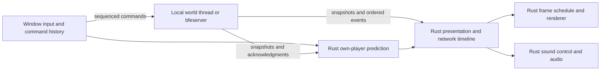

# Runtime timing and ownership

`bfe-client` runs a headless authoritative world on a dedicated local thread for
Instant Action battles. An online client instead receives that world's snapshots
from `bfeserver`. Both authorities use the native Rust simulation (`rust/sim`)
and share the same presentation (`rust/bfe-presentation`) and rendering
(`rust/bfe-render`) crates.

## World tick

`bfe-client`'s local battle thread (`rust/bfe-client/rust/local/`) and
`bfeserver` (`rust/bfe-server`) schedule integer 60 Hz gameplay ticks. Vehicle
physics keeps its 120 Hz substeps. Display refresh, graphics settings and frame
caps do not change these rates. Elapsed monotonic time determines how many fixed
steps are due; catch-up work is bounded and remaining debt is reported rather
than hidden by a larger simulation `dt`.

The host admits external input and prepares retained owner banks, then calls
one world operation (`rust/sim/rust/world/step.rs`). The Rust coordinator
advances water, squad commands, the viewpoint clock and camera, AI,
units/vehicles/recon/separation, live objects, ordnance, items, the battle tail
and grenade dangers, returning a generated `WorldTickOutput`.

`rust/sim/rust/world/owner.rs` owns the canonical store, collision, movement,
pose, AI, fleet, unit, combat, ordnance, battle, input, wire and page services.
Internal calls borrow those owners. Damage, death, boarding and shot callbacks
keep their original observation order. Completed publication commits changed
rows against the host's consumed baseline.

## Threads and data flow

One owner mutates authoritative world state. Prediction uses private state and
replays unacknowledged commands without editing the authority. Displayed bodies,
hulls, riders, props, weapons and effects are sampled by Rust presentation.
Authoritative muzzle, rider and collision geometry is computed from native rigs
even in a headless battle.

The render thread never waits synchronously for a world or network reply. It
draws the available state (`worldRendererBlocks == 0`). Bounded snapshot and
event transport lets world ticks continue through a renderer stall; reliable
input and events are not discarded with a superseded transform sample. Local
pause and suspension are explicit messages. An online authority continues while
a client loses focus or reconnects.

`bfe-client` owns its window, input devices, UDP connection and `cpal` audio
device directly.

## Input, prediction and snapshots

- Commands distinguish capture time from assigned simulation tick. Sequence,
  session epoch, body generation, held state, ordered action edges and raw look
  samples qualify what the world consumes.
- Raw mouse counts are displacement. They are not multiplied by render `dt`.
  Sensitivity, zoom and posture rules apply at their defined input boundary.
  Short presses survive slow frames. Clearing input releases held controls.
- Spawn, class, team and respawn choices are command data. Admission validates
  their bounds and the current player's life; stale commands cannot control a
  replacement body or seat.
- Snapshots contain values and qualified identities. Lifecycle, seats,
  inventory, weapon state and presentation events have explicit records.
- Rust prediction restores an authoritative checkpoint, removes acknowledged
  input and replays the pending records using the shared movement, vehicle,
  weapon and recon cores. Visual correction is smoothed separately from
  authoritative collision state.
- The Rust network owner decodes received baselines and samples retained
  timelines. Remote interpolation uses a bounded delay and extrapolation;
  immediate local look does not inherit that remote delay.
- Gameplay random streams remain separate from visual randomness. Whole-world
  replay must include admission, clock, command and stream state, not only a
  seed. Floating-point agreement is checked against recorded reference output.

The game uses server authority and reconciliation. It does not require every
client to simulate an entire battle in deterministic lockstep. See
[network-contract.md](network-contract.md),
[network-replay-contract.md](network-replay-contract.md) and
[world-replay.md](world-replay.md).

## Presentation and rendering

Rust presentation computes the gameplay camera, displayed poses, skin data,
ordnance and item views. Rust rendering derives shadow, reflection, probe and
far cameras, lighting, resource descriptors and the complete battle frame
schedule (`battle_frame`).

Frame caps skip presentation callbacks without skipping authority ticks.
Adaptive resolution changes the back buffer, using available GPU timing or
fence evidence, within the configured limits. Quality changes must not alter
battle populations, decision budgets or gameplay `dt`.

See [native-client.md](native-client.md) for `bfe-client`'s command-line modes
and application state machine.

## Validation and performance

`cargo xtask matrix` (`rust/xtask (matrix.rs)`) compares state, deep digest
and publication hashes across the 61-cell world-hash matrix against the frozen
reference in `tests/fixtures/world-hashes.json`. Native phase fixtures and
recorded input replays (`rust/sim-replay`) check shared core behavior.
[renderer-smoke.md](renderer-smoke.md) describes content-free GPU checks;
[host-qualification.md](host-qualification.md) covers server lifecycle, load
and network acceptance.

Stable 30 FPS on weaker PCs is a target, not a guaranteed minimum hardware
specification. Measure the same content, population, camera and settings on the
target device. Report render-thread CPU, world ticks, GPU cost, memory and input
latency separately. A stopped world or software renderer cannot qualify a
performance improvement. Existing measurements and their scope are in
[performance.md](performance.md) and [render-performance.md](render-performance.md).
